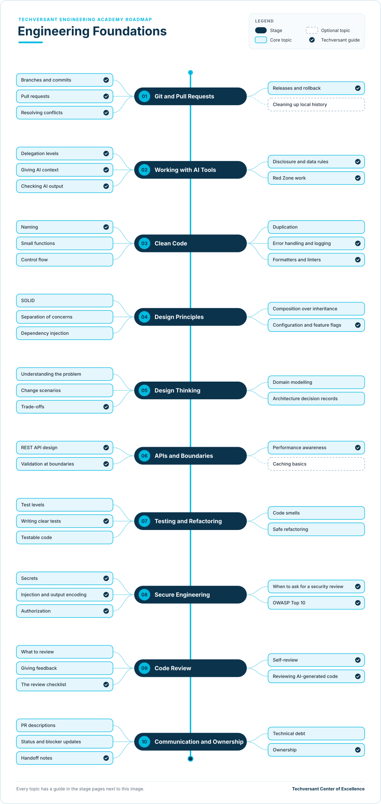

# Engineering Foundations Roadmap

**Status:** Draft · **Owner:** CoE Team · **Last updated:** 2026-11-06 · **Next review:** 2027-02-06

Engineering Foundations is the shared baseline for every Techversant engineer, in any stack. It covers the habits
that make your work easy to review, safe to ship and easy for someone else to pick up: Git and pull requests, using
AI tools safely, clean code, design, testing, security, code review and communication.

- **Who it is for:** every engineer who writes or reviews code at Techversant: new joiners, developers in any
  stack, senior developers and QA automation engineers.
- **Before you start:** you can build and run a small application in at least one language. This roadmap teaches
  engineering habits, not a language.
- **What you do:** ten stages, each with a short guide to every topic and one hands-on project on a shared
  practice app.

## Why It Matters

### The Value You Create

- **Your work gets reviewed and merged faster.** Pull requests that follow one workflow and read clearly need fewer
  rounds of review.
- **Fewer bugs reach clients.** Tests, error handling and secure coding habits catch problems before release, not
  after.
- **Anyone can pick up your work.** Clear code, pull request descriptions and handoff notes let a teammate carry on
  when you move to another project or take leave.
- **You get the speed of AI tools without the risk.** You know what to hand to an AI assistant, how to check its
  work, and what must never leave your hands.

### How You Grow

- **The base for every other path.** The Software Engineering, Quality Engineering, Software Architect, Forward
  Deployed Engineer and ColdFusion consulting roadmaps all assume these habits.
- **Evidence for your next step.** The verified projects are evidence for the
  [Junior to Senior](../career-progression/02-junior-to-senior.md) move.
- **You start reviewing others.** Once you complete the roadmap, you review your peers' work with the same
  checklist, which is the first step towards leading a team.

## What Foundations Covers

Every Techversant engineer, in every stack, should be able to:

1. Ship a change through a branch and a reviewed pull request, following the Techversant Git workflow.
2. Choose how much to hand to an AI tool, check its output, and keep Red Zone work and client data safe.
3. Write code another developer can understand without asking you.
4. Structure code so it is easy to test and change.
5. Think through a problem and its trade-offs before building, and record the decision.
6. Build APIs that follow the Techversant standard and validate every input.
7. Prove a change works with tests, and improve code safely with refactoring.
8. Spot common security risks, and know when to ask for a security review.
9. Review a teammate's work with an objective checklist, in a helpful tone.
10. Explain your work in writing: pull requests, status updates and handoff notes.

## Levels

| Level | What the engineer does | Evidence |
|-------|------------------------|----------|
| Foundation | Follows the habits on their own work, with a reviewer catching gaps | Projects for stages 01–03 and 08 verified |
| Practitioner | Follows all the habits without prompting, and reviews others' work with the checklist | All ten projects and the capstone verified |

The levels follow the academy's [learning levels](../learning-levels/README.md). Practitioner is the target of this
roadmap. Each topic's level shows the depth expected of a Practitioner.

## Where You Start

Everyone completes all ten stages. Your current role decides where you can move quickly and where to plan more time.

| Stage | New joiner | Developer | Senior developer | QA automation engineer |
|-------|------------|-----------|------------------|------------------------|
| [01. Git and Pull Requests](./01-git-and-pull-requests.md) | Partly | Already do | Already do | Already do |
| [02. Working with AI Tools](./02-working-with-ai-tools.md) | New | Partly | Partly | Partly |
| [03. Clean Code](./03-clean-code.md) | New | Partly | Already do | Partly |
| [04. Design Principles](./04-design-principles.md) | New | Partly | Already do | New |
| [05. Design Thinking](./05-design-thinking.md) | New | New | Partly | New |
| [06. APIs and Boundaries](./06-apis-and-boundaries.md) | New | Partly | Already do | Partly |
| [07. Testing and Refactoring](./07-testing-and-refactoring.md) | New | Partly | Already do | Partly |
| [08. Secure Engineering](./08-secure-engineering.md) | New | Partly | Partly | Partly |
| [09. Code Review](./09-code-review.md) | New | Partly | Already do | Partly |
| [10. Communication and Ownership](./10-communication-and-ownership.md) | New | Partly | Already do | Partly |

- **Already do:** you do this in your current role. Show your reviewer the evidence for the project, then move on.
- **Partly:** you know some of the topics. Read the stage page and learn the rest.
- **New:** start at the beginning of the stage and plan the most time here.

What each role brings:

- **New joiner:** you can write code. The new parts are working in a team: workflow, review, security and the
  habits that keep shared code healthy.
- **Developer:** you already ship features. The new parts are usually design, deliberate testing and reviewing
  others objectively.
- **Senior developer:** you probably do most of this already. Use the projects to show the evidence, and focus on
  the Techversant-specific parts: the AI rules, the security checklist and the review checklist.
- **QA automation engineer:** you already write test code, use Git and review test changes. The new parts are
  designing application code and APIs, which helps you test them better.

## The Roadmap

- Work from top to bottom. Each stage page explains every topic and ends with a project.
- **Solid boxes** are core topics. **Dashed boxes** are optional.
- A **tick** marks a Techversant guide: a standard, checklist or academy path that covers the topic. The other
  topics link to official documentation or well-known books, or are learned with a reviewer.
- Most topics end with **In your stack** notes on what the topic looks like in web front end, back end and mobile
  work.

## Stages and Projects

Each project has a verification checklist. A reviewer, senior engineer or lead checks every item before the project
counts.

| Stage | Project |
|-------|---------|
| [01. Git and Pull Requests](./01-git-and-pull-requests.md) | [Ship your first change](./01-git-and-pull-requests.md#project-ship-your-first-change) |
| [02. Working with AI Tools](./02-working-with-ai-tools.md) | [Explore and test with an AI assistant](./02-working-with-ai-tools.md#project-explore-and-test-with-an-ai-assistant) |
| [03. Clean Code](./03-clean-code.md) | [Clean up one module](./03-clean-code.md#project-clean-up-one-module) |
| [04. Design Principles](./04-design-principles.md) | [Extract a service and inject its dependencies](./04-design-principles.md#project-extract-a-service-and-inject-its-dependencies) |
| [05. Design Thinking](./05-design-thinking.md) | [Design article bookmarks](./05-design-thinking.md#project-design-article-bookmarks) |
| [06. APIs and Boundaries](./06-apis-and-boundaries.md) | [Build the bookmarks API](./06-apis-and-boundaries.md#project-build-the-bookmarks-api) |
| [07. Testing and Refactoring](./07-testing-and-refactoring.md) | [Test the feature and refactor one smell](./07-testing-and-refactoring.md#project-test-the-feature-and-refactor-one-smell) |
| [08. Secure Engineering](./08-secure-engineering.md) | [Security-review your feature](./08-secure-engineering.md#project-security-review-your-feature) |
| [09. Code Review](./09-code-review.md) | [Review three pull requests](./09-code-review.md#project-review-three-pull-requests) |
| [10. Communication and Ownership](./10-communication-and-ownership.md) | [Hand over your feature](./10-communication-and-ownership.md#project-hand-over-your-feature) |

The projects build on each other. They all use the same [practice app](./practice-app.md), the open-source RealWorld
blogging app, in a stack close to yours. You set it up, clean it up and restructure it, then design, build, test,
secure, review and hand over one new feature: article bookmarks. The app's own API and end-to-end test suites
check that nothing else breaks.

## Capstone

The ten verified projects form your capstone. Walk your reviewer or lead through them in 45 minutes:

1. Open your bookmarks pull request and walk through it: the branch, the commits, the description and how it was
   reviewed.
2. Show the design note and decision record, and one trade-off you made.
3. Show the tests, including one you proved can fail, and the RealWorld test suites passing.
4. Show your security review, one piece of AI output you rejected or changed, and why.
5. Show the feedback you gave on a peer's pull request, and the handoff note for your feature.

Your reviewer signs off the capstone when every verification item is checked and all five parts are covered. This
is the evidence for the Practitioner level.

## How to Use It

**On your own:**

1. Find your column in [Where You Start](#where-you-start).
2. Rate yourself on each topic: 0 not started, 1 aware, 2 can do it with help, 3 can do it alone.
3. Agree the order of stages with your lead, and ask for a reviewer for your projects.
4. Complete the projects. Apply each habit on your real project work at the same time.
5. Review your ratings with your lead every quarter.

**As a cohort:** a senior engineer can run the roadmap for a small group over eight weeks, with one session and one
project a week:

| Week | Stages |
|------|--------|
| 1 | 01 Git and Pull Requests, 02 Working with AI Tools |
| 2 | 03 Clean Code |
| 3 | 04 Design Principles |
| 4 | 05 Design Thinking |
| 5 | 06 APIs and Boundaries |
| 6 | 07 Testing and Refactoring |
| 7 | 08 Secure Engineering |
| 8 | 09 Code Review, 10 Communication and Ownership, then the capstone |

If you are running a cohort, read the [facilitator guide](./facilitator-guide.md).

**After Foundations:** choose a path in the [Engineering Academy](../README.md). If you want to lead a team, the
[Career Progression](../career-progression/01-transition-overview.md) guides describe the next steps.

## Glossary

| Term | Meaning |
|------|---------|
| Pull request (PR) | A request to merge a branch, where teammates review the change before it goes in |
| Conventional Commits | A standard format for commit messages, such as `feat(auth): add login` |
| Delegation level | How much of a task you hand to an AI tool: full delegate, collaborate, human-led or never delegate |
| Red Zone | Work Techversant never delegates to AI. See [section 2.2 of the AI Era Coding Guidelines](../../standards/general/ai-era-coding-guidelines.md#22-red-zone-manual-only). |
| Code smell | A sign in the code that a design problem may be hiding, such as a very long function |
| Refactoring | Changing the structure of code without changing what it does |
| ADR | Architecture decision record: a short document that records one decision, its context and its consequences |
| OWASP Top 10 | A list of the most critical web application security risks, published by the OWASP Foundation |
| Technical debt | A shortcut taken on purpose that will cost time later, and needs to be tracked |
