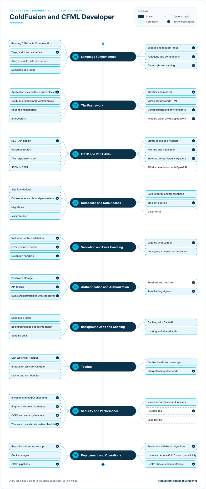

# ColdFusion and CFML Developer Roadmap

**Status:** Draft · **Owner:** CoE Team · **Last updated:** 2026-11-20 · **Next review:** 2027-05-20

A ColdFusion developer at Techversant builds and maintains the back end of client applications written in CFML
(ColdFusion Markup Language). Some projects are new APIs built with the ColdBox framework; many are long-running
applications that need careful changes, upgrades and fixes. Practice uses Lucee 7.1, the long-term support release, and
ColdBox 8; stage 10 checks the result on Adobe ColdFusion 2025.

- **Who it is for:** new joiners, front-end developers moving to the back end, back-end developers coming from
  another stack, and developers who already maintain CFML code but want modern practice.
- **Before you start:** complete [Engineering Foundations](../../../00-engineering-foundations/README.md), or show
  your lead its evidence. You should be able to read basic code in any programming language and basic HTML.
- **What you do:** ten stages, each with a short guide to every topic and one hands-on project. From stage 02, the
  projects build a complete API for the RealWorld blogging app.

## Why It Matters

### The Value You Create

- **Clients get APIs they can rely on.** Correct data, clear errors and steady performance are what every screen and
  integration depends on.
- **Older applications keep earning their keep.** You make safe changes to code you did not write, and leave it
  easier to change than you found it.
- **Client data stays safe.** You follow Techversant's rules for sign-in, permissions and data handling, and the
  Red Zone work gets a senior engineer's review.
- **Fewer problems reach production.** Tests, a repeatable server set-up and checks on both engines catch mistakes
  before users do.

### How You Grow

- **From one page to the whole back end.** You start by fixing and building features with review, and grow into
  owning the back end of a project: data design, security, background work and operations.
- **Deeper ColdFusion work later.** Experienced ColdFusion developers continue to the
  [Senior ColdFusion Consultant](../../../07-consulting/coldfusion/README.md) roadmap: audits, upgrades and migration.
- **Wider roles later.** Back-end depth leads into the
  [Software Architect](../../../04-architecture/README.md) and
  [Forward Deployed Engineer](../../../08-forward-deployed-engineering/README.md) roadmaps.

## Levels

| Level | What the developer does | Evidence |
|-------|-------------------------|----------|
| Practitioner | Builds ColdFusion features with a reviewer: pages, endpoints, data access, validation and tests | Projects for stages 01–06 verified |
| Advanced | Owns the back end of a project: data design, security, background work, testing and production readiness on both engines | All ten projects and the capstone verified, plus an API or feature shipped on a real project |

The levels follow the academy's [learning levels](../../../learning-levels/README.md). Advanced is the target of this
roadmap. Each topic's level shows the depth expected at Advanced.

## Where You Start

Everyone completes all ten stages. Your current role decides where you can move quickly and where to plan more time.

| Stage | New joiner | Front-end developer | Back-end developer, other stack | ColdFusion developer |
|-------|------------|---------------------|---------------------------------|----------------------|
| [01. Language Fundamentals](./01-language-fundamentals.md) | New | New | Partly | Already do |
| [02. The Framework](./02-the-framework.md) | New | New | New | Partly |
| [03. HTTP and REST APIs](./03-http-and-rest-apis.md) | New | Partly | Already do | Partly |
| [04. Databases and Data Access](./04-databases-and-data-access.md) | New | New | Partly | Partly |
| [05. Validation and Error Handling](./05-validation-and-error-handling.md) | New | Partly | Partly | Partly |
| [06. Authentication and Authorization](./06-authentication-and-authorization.md) | New | New | Partly | Partly |
| [07. Background Jobs and Caching](./07-background-jobs-and-caching.md) | New | New | Partly | Partly |
| [08. Testing](./08-testing.md) | New | Partly | Partly | New |
| [09. Security and Performance](./09-security-and-performance.md) | New | New | Partly | Partly |
| [10. Deployment and Operations](./10-deployment-and-operations.md) | New | New | Partly | Partly |

- **Already do:** you do this in your current role. Show your reviewer the evidence for the project, then move on.
- **Partly:** you know some of the topics. Read the stage page and learn the rest.
- **New:** start at the beginning of the stage and plan the most time here.

What each role brings:

- **New joiner:** you are learning CFML, HTTP and a framework together. Take the stages in order and expect the
  longest path.
- **Front-end developer:** you already know HTTP from the browser side, JSON and API errors. The new parts are CFML,
  databases, security on the server and running services.
- **Back-end developer, other stack:** you already know APIs, databases and testing. The new parts are CFML, its
  scopes and two engines, and ColdBox's way of doing things.
- **ColdFusion developer:** you probably know the language well. Focus on ColdBox, automated tests, Techversant's
  standards, the Red Zone rules and running the same code on Lucee and Adobe ColdFusion.

## The Roadmap

- Work from top to bottom. Each stage page explains every topic and ends with a project.
- **Solid boxes** are core topics. **Dashed boxes** are optional.
- A **tick** marks a Techversant guide: a standard, checklist or academy path that covers the topic. The other
  topics link to official documentation.

## Stages and Projects

Each project has a verification checklist. A reviewer, senior engineer or lead checks every item before the project
counts.

| Stage | Project |
|-------|---------|
| [01. Language Fundamentals](./01-language-fundamentals.md) | [Build and debug a service-request list](./01-language-fundamentals.md#project-build-and-debug-a-service-request-list) |
| [02. The Framework](./02-the-framework.md) | [Start the API](./02-the-framework.md#project-start-the-api) |
| [03. HTTP and REST APIs](./03-http-and-rest-apis.md) | [Shape every endpoint](./03-http-and-rest-apis.md#project-shape-every-endpoint) |
| [04. Databases and Data Access](./04-databases-and-data-access.md) | [Store the data](./04-databases-and-data-access.md#project-store-the-data) |
| [05. Validation and Error Handling](./05-validation-and-error-handling.md) | [Validate every request](./05-validation-and-error-handling.md#project-validate-every-request) |
| [06. Authentication and Authorization](./06-authentication-and-authorization.md) | [Add sign-in and permissions](./06-authentication-and-authorization.md#project-add-sign-in-and-permissions) |
| [07. Background Jobs and Caching](./07-background-jobs-and-caching.md) | [Add notifications, caching and a nightly report](./07-background-jobs-and-caching.md#project-add-notifications-caching-and-a-nightly-report) |
| [08. Testing](./08-testing.md) | [Pass the full test suite](./08-testing.md#project-pass-the-full-test-suite) |
| [09. Security and Performance](./09-security-and-performance.md) | [Harden and speed up the API](./09-security-and-performance.md#project-harden-and-speed-up-the-api) |
| [10. Deployment and Operations](./10-deployment-and-operations.md) | [Make it production-ready on both engines](./10-deployment-and-operations.md#project-make-it-production-ready-on-both-engines) |

Stage 01's project is a small standalone CFML page, so you learn the language before the framework. From stage 02, the
projects build one app step by step: the API for **RealWorld**, an open-source Medium-style blogging app also used in
Engineering Foundations. See the [practice app](../practice-app.md) page for how to set it up. Because every RealWorld
API follows the same specification, RealWorld's own API tests check your work the same way for everyone, and any
RealWorld front end works with your API, including one you build in a [front-end path](../../02-frontend/README.md).

## Capstone

The ten verified projects form your capstone: a complete, production-ready RealWorld API in ColdBox. Present it to
your lead in one hour:

1. Demo the API with a RealWorld front end: sign up, write an article, comment, follow and favourite. Then show your
   server-rendered home page and its browser code.
2. Show the RealWorld API tests passing, and your own TestBox tests.
3. Walk through the data model, and how you kept queries fast and parameterised.
4. Walk through sign-in and permissions: how passwords and tokens are handled, and who reviewed the code.
5. Show the production set-up: the Docker image, the pipeline, logs, the health check, and the smoke run on Adobe
   ColdFusion with the differences you found.

Your lead signs off the capstone when every verification item is checked and all five parts are covered. Together
with work shipped on a real project, this is the evidence for the Advanced level.

## How to Use It

1. Find your column in [Where You Start](#where-you-start).
2. Rate yourself on each topic: 0 not started, 1 aware, 2 can do it with help, 3 can do it alone.
3. Agree a timeline for the stages with your lead, and ask for a reviewer for your projects.
4. Complete the projects, and apply each topic on your real project work at the same time.
5. Review your ratings with your lead every quarter.

## Using AI Tools on This Path

Follow the [delegation levels](../../../../standards/general/ai-era-coding-guidelines.md#21-delegation-levels) in the
Techversant AI Era Coding Guidelines:

- **Full delegate:** test stubs, sample data, explaining a concept, an error message or an unfamiliar legacy template
- **Collaborate:** handlers, models, queries and validation rules, which you review line by line
- **Human-led:** the data model, migrations for your own environments, the API contract, engine choices and code
  review
- **Never delegate:** sign-in, token, session and permission code, password handling, and migrations that run on a
  production database. These are Red Zone work: write them by hand and have a senior engineer review them.

## Glossary

| Term | Meaning |
|------|---------|
| CFML | ColdFusion Markup Language: the language, written as tags such as `<cfset>` or as script |
| Engine | The server that runs CFML. Lucee is open source; Adobe ColdFusion is commercial. |
| CommandBox | A command-line tool that starts a CFML server, installs packages and runs tasks |
| CFC | ColdFusion Component: a `.cfc` file that groups related functions, like a class |
| Scope | A named collection of variables, such as `url`, `form`, `variables` or `local` |
| `Application.cfc` | The file that configures an application and runs code at the start of each request |
| ColdBox | The main CFML framework, from Ortus Solutions, with routing, handlers and modules |
| Handler | A ColdBox component that handles requests, like a controller |
| Interceptor | ColdBox code that runs at set points in every request, such as adding a request ID |
| WireBox | ColdBox's dependency injection library, which creates objects and passes in what they need |
| `cfqueryparam` | The tag, or parameter in `queryExecute()`, that sends a value to the database separately from the SQL |
| TestBox | The testing framework for CFML, used for unit and integration tests |
| Hurl | A command-line tool that runs HTTP requests from text files; RealWorld's API tests are Hurl files |
| Red Zone | Work Techversant never delegates to AI. See [section 2.2 of the AI Era Coding Guidelines](../../../../standards/general/ai-era-coding-guidelines.md#22-red-zone-manual-only). |
