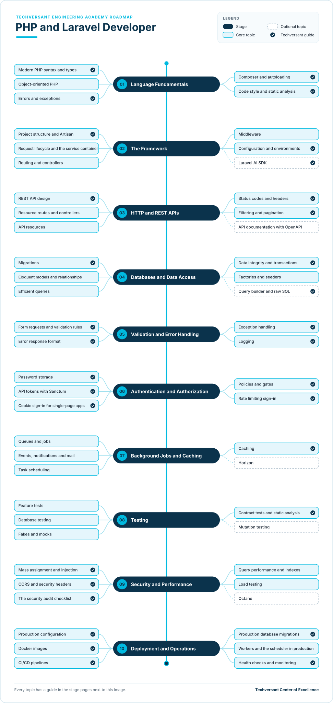

# PHP and Laravel Developer Roadmap

**Status:** Draft · **Owner:** CoE Team · **Last updated:** 2026-11-06 · **Next review:** 2027-02-06

A PHP and Laravel developer at Techversant builds the back end of client applications: the APIs, data, background
work and integrations behind every screen. Laravel is Techversant's main back-end framework, and on most projects it
serves a React and Next.js front end.

- **Who it is for:** new joiners, front-end developers moving to the back end, and back-end developers coming from
  another stack, such as Node.js or ColdFusion.
- **Before you start:** complete [Engineering Foundations](../../../00-engineering-foundations/README.md), or show
  your lead its evidence. You should be able to read basic PHP or another programming language.
- **What you do:** ten stages, each with a short guide to every topic and one hands-on project. Together, the
  projects build a complete API for the RealWorld blogging app.

## Why It Matters

### The Value You Create

- **Clients get APIs they can rely on.** Correct data, clear errors and steady performance are what every screen and
  integration depends on.
- **The front end and back end fit together first time.** You build to an agreed contract, return the errors it
  promises, and work with the front-end team instead of around them.
- **Client data stays safe.** You follow Techversant's rules for sign-in, permissions and data handling, and the
  Red Zone work gets a senior engineer's review.
- **Fewer problems reach production.** Tests, static analysis and a repeatable deployment catch mistakes before
  users do.

### How You Grow

- **From one endpoint to the whole back end.** You start by building features with review, and grow into owning the
  back end of a project: data design, security, background work and operations.
- **A path to full-stack.** Add a [front-end path](../../02-frontend/README.md) and you can deliver a whole feature,
  end to end.
- **Wider roles later.** Back-end depth leads into the
  [Software Architect](../../../04-architecture/README.md) and
  [Forward Deployed Engineer](../../../08-forward-deployed-engineering/README.md) roadmaps.

## Levels

| Level | What the developer does | Evidence |
|-------|-------------------------|----------|
| Practitioner | Builds Laravel features with a reviewer: endpoints, data access, validation and tests | Projects for stages 01–06 verified |
| Advanced | Owns the back end of a project: data design, security, background work, testing and production readiness | All ten projects and the capstone verified, plus an API shipped on a real project |

The levels follow the academy's [learning levels](../../../learning-levels/README.md). Advanced is the target of this
roadmap. Each topic's level shows the depth expected at Advanced.

## Where You Start

Everyone completes all ten stages. Your current role decides where you can move quickly and where to plan more time.

| Stage | New joiner | Front-end developer | Back-end developer, other stack | Laravel developer |
|-------|------------|---------------------|---------------------------------|-------------------|
| [01. Language Fundamentals](./01-language-fundamentals.md) | New | New | Partly | Already do |
| [02. The Framework](./02-the-framework.md) | New | New | New | Already do |
| [03. HTTP and REST APIs](./03-http-and-rest-apis.md) | New | Partly | Already do | Already do |
| [04. Databases and Data Access](./04-databases-and-data-access.md) | New | New | Partly | Partly |
| [05. Validation and Error Handling](./05-validation-and-error-handling.md) | New | Partly | Partly | Partly |
| [06. Authentication and Authorization](./06-authentication-and-authorization.md) | New | New | Partly | Partly |
| [07. Background Jobs and Caching](./07-background-jobs-and-caching.md) | New | New | Partly | Partly |
| [08. Testing](./08-testing.md) | New | Partly | Partly | Partly |
| [09. Security and Performance](./09-security-and-performance.md) | New | New | Partly | Partly |
| [10. Deployment and Operations](./10-deployment-and-operations.md) | New | New | Partly | Partly |

- **Already do:** you do this in your current role. Show your reviewer the evidence for the project, then move on.
- **Partly:** you know some of the topics. Read the stage page and learn the rest.
- **New:** start at the beginning of the stage and plan the most time here.

What each role brings:

- **New joiner:** you are learning PHP, HTTP and Laravel together. Take the stages in order and expect the longest
  path.
- **Front-end developer:** you already know HTTP from the browser side, JSON and API errors. The new parts are PHP,
  databases, security on the server and running services.
- **Back-end developer, other stack:** you already know APIs, databases and testing. The new parts are PHP and
  Laravel's way of doing them: Eloquent, the service container, queues and Sanctum.
- **Laravel developer:** you probably build with Laravel already. Focus on Techversant's standards, the Red Zone
  rules, static analysis and production readiness.

## The Roadmap

- Work from top to bottom. Each stage page explains every topic and ends with a project.
- **Solid boxes** are core topics. **Dashed boxes** are optional.
- A **tick** marks a Techversant guide: a standard, checklist or academy path that covers the topic. The other
  topics link to official documentation.

## Stages and Projects

Each project has a verification checklist. A reviewer, senior engineer or lead checks every item before the project
counts.

| Stage | Project |
|-------|---------|
| [01. Language Fundamentals](./01-language-fundamentals.md) | [Write a slug library in plain PHP](./01-language-fundamentals.md#project-write-a-slug-library-in-plain-php) |
| [02. The Framework](./02-the-framework.md) | [Start the API](./02-the-framework.md#project-start-the-api) |
| [03. HTTP and REST APIs](./03-http-and-rest-apis.md) | [Shape every endpoint](./03-http-and-rest-apis.md#project-shape-every-endpoint) |
| [04. Databases and Data Access](./04-databases-and-data-access.md) | [Store the data](./04-databases-and-data-access.md#project-store-the-data) |
| [05. Validation and Error Handling](./05-validation-and-error-handling.md) | [Validate every request](./05-validation-and-error-handling.md#project-validate-every-request) |
| [06. Authentication and Authorization](./06-authentication-and-authorization.md) | [Add sign-in and permissions](./06-authentication-and-authorization.md#project-add-sign-in-and-permissions) |
| [07. Background Jobs and Caching](./07-background-jobs-and-caching.md) | [Add notifications and caching](./07-background-jobs-and-caching.md#project-add-notifications-and-caching) |
| [08. Testing](./08-testing.md) | [Pass the full test suite](./08-testing.md#project-pass-the-full-test-suite) |
| [09. Security and Performance](./09-security-and-performance.md) | [Harden and speed up the API](./09-security-and-performance.md#project-harden-and-speed-up-the-api) |
| [10. Deployment and Operations](./10-deployment-and-operations.md) | [Make it production-ready](./10-deployment-and-operations.md#project-make-it-production-ready) |

The projects build one app step by step: the API for **RealWorld**, an open-source Medium-style blogging app also
used in Engineering Foundations. See the [practice app](../practice-app.md) page for how to set it up. Because every
RealWorld API follows the same specification, RealWorld's own API tests check your work the same way for everyone,
and any RealWorld front end works with your API, including one you build in a
[front-end path](../../02-frontend/README.md).

## Capstone

The ten verified projects form your capstone: a complete, production-ready RealWorld API in Laravel. Present it to
your lead in one hour:

1. Demo the API with a RealWorld front end: sign up, write an article, comment, follow and favourite.
2. Show the RealWorld API tests passing, and your own feature tests and static analysis.
3. Walk through the data model, and how you kept queries fast.
4. Walk through sign-in and permissions: how tokens are stored and checked, and who reviewed the code.
5. Show the production setup: the Docker image, the pipeline, queue workers, logs and the health check.

Your lead signs off the capstone when every verification item is checked and all five parts are covered. Together
with an API shipped on a real project, this is the evidence for the Advanced level.

## How to Use It

1. Find your column in [Where You Start](#where-you-start).
2. Rate yourself on each topic: 0 not started, 1 aware, 2 can do it with help, 3 can do it alone.
3. Agree a timeline for the stages with your lead, and ask for a reviewer for your projects.
4. Complete the projects, and apply each topic on your real project work at the same time.
5. Review your ratings with your lead every quarter.

## Using AI Tools on This Path

Follow the [delegation levels](../../../../standards/general/ai-era-coding-guidelines.md#21-delegation-levels) in the
Techversant AI Era Coding Guidelines:

- **Full delegate:** test stubs, factories and seeders, explaining a concept or an error message
- **Collaborate:** controllers, API resources, validation rules and queued jobs, which you review line by line
- **Human-led:** the data model, migrations for your own environments, the API contract and code review
- **Never delegate:** sign-in, token and permission code, password handling, and migrations that run on a production
  database. These are Red Zone work: write them by hand and have a senior engineer review them.

## Glossary

| Term | Meaning |
|------|---------|
| Composer | PHP's package manager, which installs libraries and loads classes automatically |
| Artisan | Laravel's command-line tool, used to create files, run migrations and start workers |
| Service container | The part of Laravel that creates objects and passes in what they need |
| Middleware | Code that runs before or after every request on a route, such as checking the sign-in token |
| Eloquent | Laravel's database layer, where each table has a model class |
| Migration | A versioned file that changes the database structure, such as adding a table |
| N+1 query | A bug where code runs one query for a list and then one more for every item in it |
| Form request | A Laravel class that validates a request before the controller runs |
| Sanctum | Laravel's package for API tokens and cookie-based sign-in for single-page apps |
| Policy | A Laravel class that decides whether a user may act on a model, such as editing an article |
| Queue | A list of jobs that workers run in the background, outside the request |
| Red Zone | Work Techversant never delegates to AI. See [section 2.2 of the AI Era Coding Guidelines](../../../../standards/general/ai-era-coding-guidelines.md#22-red-zone-manual-only). |
