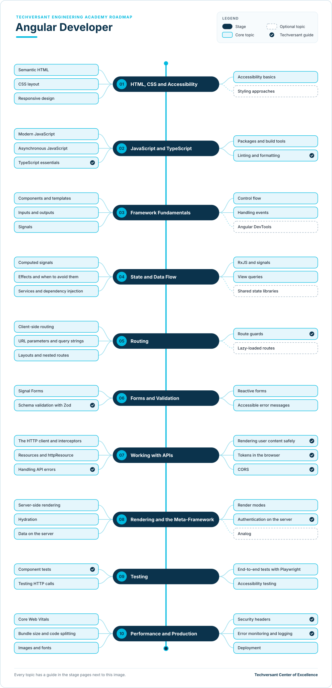

# Angular Developer Roadmap

**Status:** Draft · **Owner:** CoE Team · **Last updated:** 2026-11-06 · **Next review:** 2027-02-06

An Angular developer at Techversant builds the front end of client web applications: the pages, forms and
interactions people use every day. On most projects, Angular is the front end for an API built by the
back-end team, often in Laravel.

- **Who it is for:** new joiners, back-end developers moving to the front end, and front-end developers coming from
  another framework, such as React or Vue.
- **Before you start:** complete [Engineering Foundations](../../../00-engineering-foundations/README.md), or show
  your lead its evidence. You should be able to read basic JavaScript.
- **What you do:** ten stages, each with a short guide to every topic and one hands-on project. Together, the
  projects build a complete front end for the RealWorld blogging app.

## Why It Matters

### The Value You Create

- **Clients get interfaces people can use.** Fast, accessible pages that work on any device are often what the
  client's users judge the whole project by.
- **The front end and back end fit together first time.** You build against the API contract, handle every error it
  returns, and work with the back-end team instead of around them.
- **Fewer bugs reach users.** Typed code, component tests and end-to-end tests catch problems before release.
- **Sign-in stays safe.** You follow Techversant's rules for authentication and tokens, so client data is protected.

### How You Grow

- **From one feature to the whole front end.** You start by building components with review, and grow into owning
  the front end of a project: structure, rendering, performance and security.
- **A path to full-stack.** Add a [back-end path](../../01-backend/README.md) and you can deliver a whole feature, end
  to end.
- **Wider roles later.** Front-end depth leads into the
  [Forward Deployed Engineer](../../../08-forward-deployed-engineering/README.md) and
  [Software Architect](../../../04-architecture/README.md) roadmaps.

## Levels

| Level | What the developer does | Evidence |
|-------|-------------------------|----------|
| Practitioner | Builds Angular features with a reviewer: components, state, forms and API calls | Projects for stages 01–07 verified |
| Advanced | Owns the front end of a project: structure, rendering, testing, performance and production readiness | All ten projects and the capstone verified, plus a front end shipped on a real project |

The levels follow the academy's [learning levels](../../../learning-levels/README.md). Advanced is the target of this
roadmap. Each topic's level shows the depth expected at Advanced.

## Where You Start

Everyone completes all ten stages. Your current role decides where you can move quickly and where to plan more time.

| Stage | New joiner | Back-end developer | Front-end developer, other framework | Angular developer |
|-------|------------|--------------------|--------------------------------------|-------------------|
| [01. HTML, CSS and Accessibility](./01-html-css-and-accessibility.md) | New | Partly | Already do | Already do |
| [02. JavaScript and TypeScript](./02-javascript-and-typescript.md) | New | Partly | Already do | Already do |
| [03. Framework Fundamentals](./03-framework-fundamentals.md) | New | New | Partly | Already do |
| [04. State and Data Flow](./04-state-and-data-flow.md) | New | New | Partly | Already do |
| [05. Routing](./05-routing.md) | New | New | Partly | Partly |
| [06. Forms and Validation](./06-forms-and-validation.md) | New | Partly | Partly | Partly |
| [07. Working with APIs](./07-working-with-apis.md) | New | Partly | Partly | Partly |
| [08. Rendering and the Meta-Framework](./08-rendering-and-the-meta-framework.md) | New | New | New | Partly |
| [09. Testing](./09-testing.md) | New | Partly | Partly | Partly |
| [10. Performance and Production](./10-performance-and-production.md) | New | Partly | Partly | Partly |

- **Already do:** you do this in your current role. Show your reviewer the evidence for the project, then move on.
- **Partly:** you know some of the topics. Read the stage page and learn the rest.
- **New:** start at the beginning of the stage and plan the most time here.

What each role brings:

- **New joiner:** you are learning the web platform and Angular together. Take the stages in order and expect the
  longest path.
- **Back-end developer:** you already know HTTP, APIs, validation and testing. The new parts are the browser,
  components, state and rendering.
- **Front-end developer, other framework:** you already know HTML, CSS, TypeScript and components. The new parts are
  Angular's templates, signals, dependency injection, RxJS and built-in server rendering.
- **Angular developer:** you probably build with Angular already. Focus on signals, Signal Forms, server rendering,
  testing, and Techversant's security and production rules.

## The Roadmap

- Work from top to bottom. Each stage page explains every topic and ends with a project.
- **Solid boxes** are core topics. **Dashed boxes** are optional.
- A **tick** marks a Techversant guide: a standard, checklist or academy path that covers the topic. The other
  topics link to official documentation.

## Stages and Projects

Each project has a verification checklist. A reviewer, senior engineer or lead checks every item before the project
counts.

| Stage | Project |
|-------|---------|
| [01. HTML, CSS and Accessibility](./01-html-css-and-accessibility.md) | [Build the pages in HTML and CSS](./01-html-css-and-accessibility.md#project-build-the-pages-in-html-and-css) |
| [02. JavaScript and TypeScript](./02-javascript-and-typescript.md) | [Write a typed API client](./02-javascript-and-typescript.md#project-write-a-typed-api-client) |
| [03. Framework Fundamentals](./03-framework-fundamentals.md) | [Build the home page in Angular](./03-framework-fundamentals.md#project-build-the-home-page-in-angular) |
| [04. State and Data Flow](./04-state-and-data-flow.md) | [Add feeds, tags and pagination](./04-state-and-data-flow.md#project-add-feeds-tags-and-pagination) |
| [05. Routing](./05-routing.md) | [Add every page and route](./05-routing.md#project-add-every-page-and-route) |
| [06. Forms and Validation](./06-forms-and-validation.md) | [Build the forms](./06-forms-and-validation.md#project-build-the-forms) |
| [07. Working with APIs](./07-working-with-apis.md) | [Connect to the API and sign in](./07-working-with-apis.md#project-connect-to-the-api-and-sign-in) |
| [08. Rendering and the Meta-Framework](./08-rendering-and-the-meta-framework.md) | [Render the app on the server](./08-rendering-and-the-meta-framework.md#project-render-the-app-on-the-server) |
| [09. Testing](./09-testing.md) | [Pass the full test suite](./09-testing.md#project-pass-the-full-test-suite) |
| [10. Performance and Production](./10-performance-and-production.md) | [Make it production-ready](./10-performance-and-production.md#project-make-it-production-ready) |

The projects build one app step by step: a front end for **RealWorld**, an open-source Medium-style blogging app
also used in Engineering Foundations. See the [practice app](../practice-app.md) page for how to set it up. Because
every RealWorld front end follows the same specification, RealWorld's own Playwright tests check your work the same
way for everyone, and your front end works with any RealWorld back end, including one you build in a
[back-end path](../../01-backend/README.md).

## Capstone

The ten verified projects form your capstone: a complete, production-ready RealWorld front end in Angular. Present
it to your lead in one hour:

1. Demo the app against a RealWorld back end: sign up, write an article, comment, follow and favourite.
2. Show the RealWorld end-to-end suite passing, and your own component and end-to-end tests.
3. Explain which pages render on each request, which are prerendered, and what runs only on the server, in `server.ts`.
4. Walk through sign-in: where the token lives, why, and who reviewed the code.
5. Show the production checks: Core Web Vitals, accessibility results, security headers and the deployed build.

Your lead signs off the capstone when every verification item is checked and all five parts are covered. Together
with a front end shipped on a real project, this is the evidence for the Advanced level.

## How to Use It

1. Find your column in [Where You Start](#where-you-start).
2. Rate yourself on each topic: 0 not started, 1 aware, 2 can do it with help, 3 can do it alone.
3. Agree a timeline for the stages with your lead, and ask for a reviewer for your projects.
4. Complete the projects, and apply each topic on your real project work at the same time.
5. Review your ratings with your lead every quarter.

## Using AI Tools on This Path

Follow the [delegation levels](../../../../standards/general/ai-era-coding-guidelines.md#21-delegation-levels) in the
Techversant AI Era Coding Guidelines:

- **Full delegate:** test stubs, schema drafts from examples, explaining a concept or an error message
- **Collaborate:** components, services, styling and file structure, which you review line by line
- **Human-led:** the component structure, where state lives, the boundary between server and client code, security
  headers, and code review
- **Never delegate:** sign-in, session and token handling. These are Red Zone work: write them by hand and have a
  senior engineer review them.

## Glossary

| Term | Meaning |
|------|---------|
| Component | A reusable piece of user interface: a TypeScript class with a template |
| Template | The HTML-like part of an Angular component that describes what it shows |
| Signal | A value Angular tracks, so the page updates when it changes |
| Computed signal | A value Angular calculates from other signals and keeps up to date |
| Service | A class that holds logic or state shared by several components, passed to them by dependency injection |
| Dependency injection | Angular creating objects, such as services, and passing them to the classes that ask for them |
| Observable | An RxJS stream of values over time, used by Angular's HTTP client and router |
| Resource | An Angular object that loads data when the signals it reads change, and tracks loading and errors as signals |
| Interceptor | A function that runs on every HTTP request, used to add the token or handle errors in one place |
| Route guard | A function that runs before a route opens, used to redirect signed-out users |
| SSR | Server-side rendering: running the app on a server to send finished HTML |
| Hydration | Angular attaching to the HTML the server sent, so the page becomes interactive |
| httpOnly cookie | A cookie that browser JavaScript cannot read, which protects the token inside it from cross-site scripting |
| Core Web Vitals | Google's three measures of page experience: loading (LCP), responsiveness (INP) and visual stability (CLS) |
| Red Zone | Work Techversant never delegates to AI. See [section 2.2 of the AI Era Coding Guidelines](../../../../standards/general/ai-era-coding-guidelines.md#22-red-zone-manual-only). |
