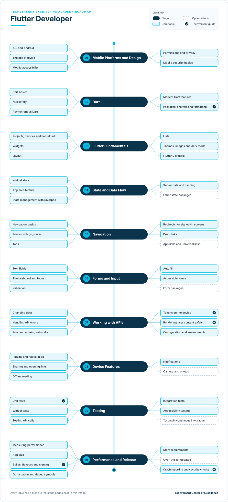

# Flutter Developer Roadmap

**Status:** Draft · **Owner:** CoE Team · **Last updated:** 2026-11-12 · **Next review:** 2027-02-12

A Flutter developer at Techversant builds mobile apps for iOS and Android from one code base, written in Dart.
Flutter draws every pixel of the interface itself, so the app looks the same on both platforms unless you choose
otherwise. On most projects the app is the mobile front end for an API built by the back-end team. This roadmap uses
Flutter 3.50 with Dart 3.14.

- **Who it is for:** new joiners, web or back-end developers moving to mobile, and native or React Native developers
  moving to Flutter.
- **Before you start:** complete [Engineering Foundations](../../../00-engineering-foundations/README.md), or show
  your lead its evidence. You should be able to read code in at least one programming language.
- **What you do:** ten stages, each with a short guide to every topic and one hands-on project. Together, the
  projects build a complete mobile client for the RealWorld blogging app.

## Why It Matters

### The Value You Create

- **Clients reach both platforms with one team.** One code base for iOS and Android means features ship on both at
  the same time, and fixes reach every user.
- **Interfaces look and behave as designed.** Flutter's own rendering gives a consistent design on every device,
  while you still follow each platform's rules for navigation, text input and accessibility.
- **Apps keep working on real networks.** You plan for slow and missing connections, so users are not left with a
  frozen screen.
- **User data stays safe on the device.** You follow Techversant's rules for tokens and secure storage.

### How You Grow

- **From one screen to the whole app.** You start by building screens with review, and grow into owning the app:
  architecture, testing, performance and store release.
- **Beyond phones.** The same Flutter skills reach tablets, the web and desktop apps when a client needs them.
- **Wider roles later.** Mobile depth leads into the
  [Forward Deployed Engineer](../../../08-forward-deployed-engineering/README.md) and
  [Software Architect](../../../04-architecture/README.md) roadmaps.

## Levels

| Level | What the developer does | Evidence |
|-------|-------------------------|----------|
| Practitioner | Builds Flutter features with a reviewer: widgets, state, navigation, forms and API calls | Projects for stages 01–07 verified |
| Advanced | Owns a mobile app: architecture, device features, testing, performance and store release | All ten projects and the capstone verified, plus an app released on a real project |

The levels follow the academy's [learning levels](../../../learning-levels/README.md). Advanced is the target of this
roadmap. Each topic's level shows the depth expected at Advanced.

## Where You Start

Everyone completes all ten stages. Your current role decides where you can move quickly and where to plan more time.

| Stage | New joiner | Web developer | Back-end developer | Native or React Native developer |
|-------|------------|---------------|--------------------|----------------------------------|
| [01. Mobile Platforms and Design](./01-mobile-platforms-and-design.md) | New | New | New | Already do |
| [02. Dart](./02-dart.md) | New | Partly | Partly | Partly |
| [03. Flutter Fundamentals](./03-flutter-fundamentals.md) | New | New | New | Partly |
| [04. State and Data Flow](./04-state-and-data-flow.md) | New | Partly | New | Partly |
| [05. Navigation](./05-navigation.md) | New | Partly | New | Partly |
| [06. Forms and Input](./06-forms-and-input.md) | New | Partly | Partly | Partly |
| [07. Working with APIs](./07-working-with-apis.md) | New | Partly | Partly | Partly |
| [08. Device Features](./08-device-features.md) | New | New | New | Partly |
| [09. Testing](./09-testing.md) | New | Partly | Partly | Partly |
| [10. Performance and Release](./10-performance-and-release.md) | New | Partly | Partly | Partly |

- **Already do:** you do this in your current role. Show your reviewer the evidence for the project, then move on.
- **Partly:** you know some of the topics. Read the stage page and learn the rest.
- **New:** start at the beginning of the stage and plan the most time here.

What each role brings:

- **New joiner:** you are learning Dart, Flutter and mobile together. Take the stages in order and expect the
  longest path.
- **Web developer:** you already know components, state, forms and API calls. The new parts are Dart, widgets
  instead of HTML and CSS, and everything that happens on the device.
- **Back-end developer:** you already know HTTP, APIs, validation and testing. The new parts are widgets, state and
  mobile platforms.
- **Native or React Native developer:** you already know the platforms, their design rules and store release. The
  new parts are Dart, Flutter's widget model and its tools.

## The Roadmap

- Work from top to bottom. Each stage page explains every topic and ends with a project.
- **Solid boxes** are core topics. **Dashed boxes** are optional.
- A **tick** marks a Techversant guide: a standard, checklist or academy path that covers the topic. The other
  topics link to official documentation.

## Stages and Projects

Each project has a verification checklist. A reviewer, senior engineer or lead checks every item before the project
counts.

| Stage | Project |
|-------|---------|
| [01. Mobile Platforms and Design](./01-mobile-platforms-and-design.md) | [Plan the app](./01-mobile-platforms-and-design.md#project-plan-the-app) |
| [02. Dart](./02-dart.md) | [Write a typed API client](./02-dart.md#project-write-a-typed-api-client) |
| [03. Flutter Fundamentals](./03-flutter-fundamentals.md) | [Build the home screen](./03-flutter-fundamentals.md#project-build-the-home-screen) |
| [04. State and Data Flow](./04-state-and-data-flow.md) | [Add feeds, tags and infinite scroll](./04-state-and-data-flow.md#project-add-feeds-tags-and-infinite-scroll) |
| [05. Navigation](./05-navigation.md) | [Add every screen and deep link](./05-navigation.md#project-add-every-screen-and-deep-link) |
| [06. Forms and Input](./06-forms-and-input.md) | [Build the forms](./06-forms-and-input.md#project-build-the-forms) |
| [07. Working with APIs](./07-working-with-apis.md) | [Connect to the API and sign in](./07-working-with-apis.md#project-connect-to-the-api-and-sign-in) |
| [08. Device Features](./08-device-features.md) | [Add sharing, offline reading and reminders](./08-device-features.md#project-add-sharing-offline-reading-and-reminders) |
| [09. Testing](./09-testing.md) | [Test every flow](./09-testing.md#project-test-every-flow) |
| [10. Performance and Release](./10-performance-and-release.md) | [Make it release-ready](./10-performance-and-release.md#project-make-it-release-ready) |

The projects build one app step by step: a mobile client for **RealWorld**, the open-source Medium-style blogging
app the web paths also build. See the [practice app](../practice-app.md) page for the screens, behaviour rules and
test flows. Because every RealWorld back end follows the same API, your app works with any of them, including one you
build in a [back-end path](../../01-backend/README.md).

## Capstone

The ten verified projects form your capstone: a complete, release-ready RealWorld mobile client. Present it to your
lead in one hour:

1. Demo the app on an iOS device or simulator and an Android device or emulator: sign up, write an article, comment,
   follow and favourite, then open an article from a deep link.
2. Show your unit, widget and integration tests passing, including the offline flow.
3. Walk through sign-in: where the token lives, why, and who reviewed the code.
4. Show the performance checks: startup time, scrolling the feed in profile mode, and the size of the app.
5. Show the release: flavours, signing, version numbers, a build delivered through internal testing, and crash
   reporting.

Your lead signs off the capstone when every verification item is checked and all five parts are covered. Together
with an app released on a real project, this is the evidence for the Advanced level.

## How to Use It

1. Find your column in [Where You Start](#where-you-start).
2. Rate yourself on each topic: 0 not started, 1 aware, 2 can do it with help, 3 can do it alone.
3. Agree a timeline for the stages with your lead, and ask for a reviewer for your projects.
4. Complete the projects, and apply each topic on your real project work at the same time.
5. Review your ratings with your lead every quarter.

## Using AI Tools on This Path

Follow the [delegation levels](../../../../standards/general/ai-era-coding-guidelines.md#21-delegation-levels) in the
Techversant AI Era Coding Guidelines:

- **Full delegate:** test stubs, model classes from API examples, explaining a concept or an error message
- **Collaborate:** widgets, layouts, themes and screen structure, which you review line by line
- **Human-led:** the app's architecture, where state lives, navigation design, permissions, build and release
  settings, and code review
- **Never delegate:** sign-up, sign-in and sign-out; token storage; the code that adds the token to requests; the
  startup session check and handling of 401 responses; route guards; and changing the email or password in
  Settings. These are Red Zone work: write them by hand and have a senior engineer review them.

## Glossary

| Term | Meaning |
|------|---------|
| Widget | A description of part of the interface, such as text, padding or a whole screen; Flutter builds the app from a tree of widgets |
| Stateless and stateful widget | A widget that only shows what it is given, and a widget that keeps state that can change |
| Hot reload | Updating the running app with code changes in about a second, while keeping its state |
| Package | A shared library of Dart code, published on pub.dev and added in `pubspec.yaml` |
| Provider | In Riverpod, an object that creates and caches a value, such as the article feed, for widgets to watch |
| Deep link | A link that opens a specific screen in the app, such as an article |
| Keychain and Keystore | The secure storage built into iOS and Android, used for tokens and other secrets |
| Flavour | A build variant of the app, such as development or production, with its own settings |
| Impeller | Flutter's rendering engine, which draws the interface on iOS and modern Android |
| Red Zone | Work Techversant never delegates to AI. See [section 2.2 of the AI Era Coding Guidelines](../../../../standards/general/ai-era-coding-guidelines.md#22-red-zone-manual-only). |
