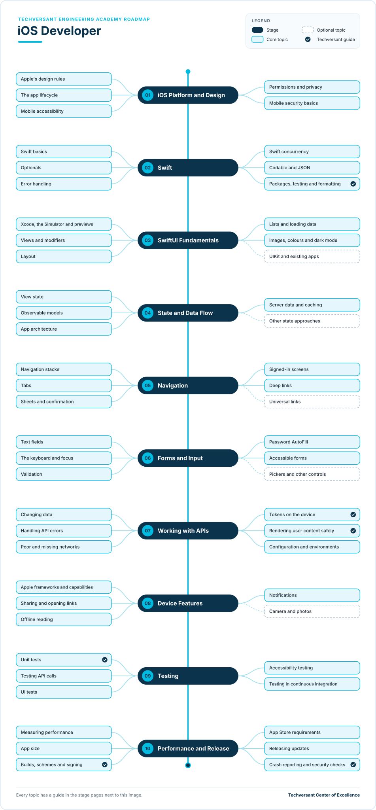

# iOS Developer Roadmap

**Status:** Draft · **Owner:** CoE Team · **Last updated:** 2026-11-18 · **Next review:** 2027-02-18

An iOS developer at Techversant builds native apps for iPhone and iPad in Swift, using Apple's own frameworks and
tools. Native apps get every new iOS feature first and feel at home on the platform. On most projects the app is the
mobile front end for an API built by the back-end team. This roadmap uses Xcode 27 with Swift 6.4 and SwiftUI, and
sets the practice app's minimum iOS version to iOS 18.

- **Who it is for:** new joiners, web or back-end developers moving to mobile, and Android, React Native or Flutter
  developers moving to native iOS.
- **Before you start:** complete [Engineering Foundations](../../../00-engineering-foundations/README.md), or show
  your lead its evidence. You should be able to read code in at least one programming language. You need a Mac that
  runs Xcode 27.
- **What you do:** ten stages, each with a short guide to every topic and one hands-on project. Together, the
  projects build a complete mobile client for the RealWorld blogging app.

## Why It Matters

### The Value You Create

- **Clients get the best of the platform.** Native apps use new iOS features, widgets and system integrations as
  soon as Apple releases them.
- **Interfaces feel right on iPhone.** SwiftUI gives you Apple's controls, navigation and accessibility features, so
  the app behaves the way iPhone users expect.
- **Apps keep working on real networks.** You plan for slow and missing connections, so users are not left with a
  frozen screen.
- **User data stays safe on the device.** You follow Techversant's rules for tokens and the Keychain.

### How You Grow

- **From one screen to the whole app.** You start by building screens with review, and grow into owning the app:
  architecture, testing, performance and App Store release.
- **Beyond the iPhone.** The same Swift and SwiftUI skills reach iPad, Apple Watch, Mac and Apple Vision Pro apps
  when a client needs them.
- **Wider roles later.** Mobile depth leads into the
  [Forward Deployed Engineer](../../../08-forward-deployed-engineering/README.md) and
  [Software Architect](../../../04-architecture/README.md) roadmaps.

## Levels

| Level | What the developer does | Evidence |
|-------|-------------------------|----------|
| Practitioner | Builds iOS features with a reviewer: views, state, navigation, forms and API calls | Projects for stages 01–07 verified |
| Advanced | Owns an iOS app: architecture, device features, testing, performance and App Store release | All ten projects and the capstone verified, plus an app released on a real project |

The levels follow the academy's [learning levels](../../../learning-levels/README.md). Advanced is the target of this
roadmap. Each topic's level shows the depth expected at Advanced.

## Where You Start

Everyone completes all ten stages. Your current role decides where you can move quickly and where to plan more time.

| Stage | New joiner | Web developer | Back-end developer | Android or cross-platform developer |
|-------|------------|---------------|--------------------|-------------------------------------|
| [01. iOS Platform and Design](./01-ios-platform-and-design.md) | New | New | New | Partly |
| [02. Swift](./02-swift.md) | New | Partly | Partly | Partly |
| [03. SwiftUI Fundamentals](./03-swiftui-fundamentals.md) | New | New | New | Partly |
| [04. State and Data Flow](./04-state-and-data-flow.md) | New | Partly | New | Partly |
| [05. Navigation](./05-navigation.md) | New | Partly | New | Partly |
| [06. Forms and Input](./06-forms-and-input.md) | New | Partly | Partly | Partly |
| [07. Working with APIs](./07-working-with-apis.md) | New | Partly | Partly | Partly |
| [08. Device Features](./08-device-features.md) | New | New | New | Partly |
| [09. Testing](./09-testing.md) | New | Partly | Partly | Partly |
| [10. Performance and Release](./10-performance-and-release.md) | New | Partly | Partly | Partly |

- **Partly:** you know some of the topics. Read the stage page and learn the rest.
- **New:** start at the beginning of the stage and plan the most time here.

What each role brings:

- **New joiner:** you are learning Swift, SwiftUI and mobile together. Take the stages in order and expect the
  longest path.
- **Web developer:** you already know components, state, forms and API calls. The new parts are Swift, SwiftUI views
  instead of HTML and CSS, and everything that happens on the device.
- **Back-end developer:** you already know HTTP, APIs, validation and testing. The new parts are views, state and
  the iOS platform.
- **Android or cross-platform developer:** you already know mobile apps, navigation and store release. The new parts
  are Swift, SwiftUI, Xcode and Apple's rules for design and review.

## The Roadmap

- Work from top to bottom. Each stage page explains every topic and ends with a project.
- **Solid boxes** are core topics. **Dashed boxes** are optional.
- A **tick** marks a Techversant guide: a standard, checklist or academy path that covers the topic. The other
  topics link to official documentation.

## Stages and Projects

Each project has a verification checklist. A reviewer, senior engineer or lead checks every item before the project
counts.

| Stage | Project |
|-------|---------|
| [01. iOS Platform and Design](./01-ios-platform-and-design.md) | [Plan the app](./01-ios-platform-and-design.md#project-plan-the-app) |
| [02. Swift](./02-swift.md) | [Write a typed API client](./02-swift.md#project-write-a-typed-api-client) |
| [03. SwiftUI Fundamentals](./03-swiftui-fundamentals.md) | [Build the home screen](./03-swiftui-fundamentals.md#project-build-the-home-screen) |
| [04. State and Data Flow](./04-state-and-data-flow.md) | [Add feeds, tags and infinite scroll](./04-state-and-data-flow.md#project-add-feeds-tags-and-infinite-scroll) |
| [05. Navigation](./05-navigation.md) | [Add every screen and deep link](./05-navigation.md#project-add-every-screen-and-deep-link) |
| [06. Forms and Input](./06-forms-and-input.md) | [Build the forms](./06-forms-and-input.md#project-build-the-forms) |
| [07. Working with APIs](./07-working-with-apis.md) | [Connect to the API and sign in](./07-working-with-apis.md#project-connect-to-the-api-and-sign-in) |
| [08. Device Features](./08-device-features.md) | [Add sharing, offline reading and reminders](./08-device-features.md#project-add-sharing-offline-reading-and-reminders) |
| [09. Testing](./09-testing.md) | [Test every flow](./09-testing.md#project-test-every-flow) |
| [10. Performance and Release](./10-performance-and-release.md) | [Make it release-ready](./10-performance-and-release.md#project-make-it-release-ready) |

The projects build one app step by step: a mobile client for **RealWorld**, the open-source Medium-style blogging
app the web paths also build. See the [practice app](../practice-app.md) page for the screens, behaviour rules and
test flows. Because every RealWorld back end follows the same API, your app works with any of them, including one you
build in a [back-end path](../../01-backend/README.md).

## Capstone

The ten verified projects form your capstone: a complete, release-ready RealWorld iOS client. Present it to your lead
in one hour:

1. Demo the app on an iPhone or the iOS Simulator: sign up, write an article, comment, follow and favourite, then
   open an article from a deep link.
2. Show your unit tests and user interface (UI) tests passing, and explain how the offline states are tested.
3. Walk through sign-in: where the token lives, why, and who reviewed the code.
4. Show the performance checks: startup time, scrolling the feed in a release build, and the size of the app.
5. Show the release: build configurations, signing, version and build numbers, a build delivered through TestFlight
   internal testing, and crash reporting.

Your lead signs off the capstone when every verification item is checked and all five parts are covered. Together
with an app released on a real project, this is the evidence for the Advanced level.

## How to Use It

1. Find your column in [Where You Start](#where-you-start).
2. Rate yourself on each topic: 0 not started, 1 aware, 2 can do it with help, 3 can do it alone.
3. Agree a timeline for the stages with your lead, and ask for a reviewer for your projects.
4. Complete the projects, and apply each topic on your real project work at the same time.
5. Review your ratings with your lead every quarter.

## Using AI Tools on This Path

Follow the [delegation levels](../../../../standards/general/ai-era-coding-guidelines.md#21-delegation-levels) in the
Techversant AI Era Coding Guidelines. Xcode's built-in coding assistants count as AI tools, so the same levels apply:

- **Full delegate:** test stubs, `Codable` types from API examples, explaining a concept or an error message
- **Collaborate:** views, layouts, modifiers and screen structure, which you review line by line
- **Human-led:** the app's architecture, where state lives, navigation design, permissions, build and signing
  settings, and code review
- **Never delegate:** sign-up, sign-in and sign-out; Keychain storage of the token; the code that adds the token to
  requests; the startup session check and handling of 401 responses; the checks that keep signed-out users off signed-in
  screens; and changing the email or password in Settings. These are Red Zone work: write them by hand and have a senior
  engineer review them.

## Glossary

| Term | Meaning |
|------|---------|
| View | A description of part of the interface, such as text, an image or a whole screen; SwiftUI builds the app from views |
| Modifier | A method that changes a view, such as `.padding()` or `.font(.title)`, and returns a new view |
| Optional | A Swift type that holds either a value or `nil`, such as `String?` |
| Observable | A class marked with the `@Observable` macro, whose changes update the views that read it |
| Swift package | A shared library of Swift code, added to a project with Swift Package Manager |
| Actor | A Swift type that protects its data from being changed by two tasks at once; the main actor runs interface code |
| Deep link | A link that opens a specific screen in the app, such as an article |
| Keychain | The secure storage built into iOS, used for tokens and other secrets |
| Scheme and build configuration | A scheme chooses what Xcode builds, runs and tests; a build configuration, such as Debug or Release, holds the settings for one kind of build |
| Provisioning profile | A file from Apple that allows a signed app to run on particular devices or be uploaded to the App Store |
| TestFlight | Apple's service for sending test builds to internal and external testers before release |
| Red Zone | Work Techversant never delegates to AI. See [section 2.2 of the AI Era Coding Guidelines](../../../../standards/general/ai-era-coding-guidelines.md#22-red-zone-manual-only). |
