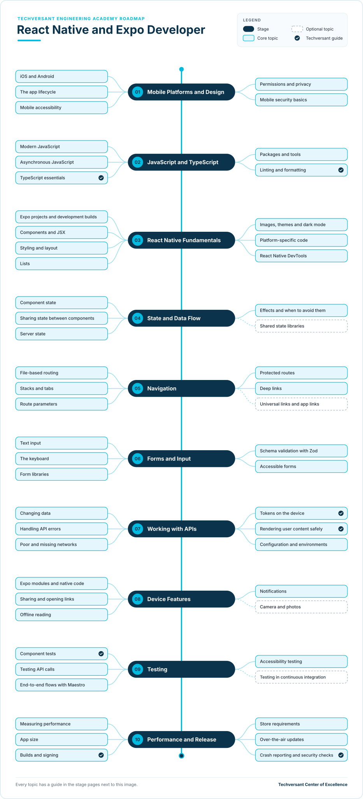

# React Native and Expo Developer Roadmap

**Status:** Draft · **Owner:** CoE Team · **Last updated:** 2026-11-11 · **Next review:** 2027-02-11

A React Native developer at Techversant builds mobile apps for iOS and Android from one TypeScript code base. On
most projects the app is the mobile front end for an API built by the back-end team, often alongside a web front end
in React. This roadmap uses Expo, the framework the React Native documentation
recommends for most developers, at Expo software development kit (SDK) 58 with React Native 0.88.

- **Who it is for:** new joiners, React developers moving to mobile, and back-end or native mobile developers moving
  to React Native.
- **Before you start:** complete [Engineering Foundations](../../../00-engineering-foundations/README.md), or show
  your lead its evidence. You should be able to read basic JavaScript.
- **What you do:** ten stages, each with a short guide to every topic and one hands-on project. Together, the
  projects build a complete mobile client for the RealWorld blogging app.

## Why It Matters

### The Value You Create

- **Clients reach both platforms with one team.** One code base for iOS and Android means features ship on both at
  the same time, and fixes reach every user.
- **Apps feel at home on each platform.** You follow each platform's conventions for navigation, keyboards and
  accessibility, so users trust the app.
- **Apps keep working on real networks.** You plan for slow and missing connections, so users are not left with a
  frozen screen.
- **User data stays safe on the device.** You follow Techversant's rules for tokens and secure storage.

### How You Grow

- **From one screen to the whole app.** You start by building screens with review, and grow into owning the app:
  structure, testing, performance and store release.
- **Web and mobile together.** React skills carry across, so you can work on a client's web and mobile front ends.
- **Wider roles later.** Mobile depth leads into the
  [Forward Deployed Engineer](../../../08-forward-deployed-engineering/README.md) and
  [Software Architect](../../../04-architecture/README.md) roadmaps.

## Levels

| Level | What the developer does | Evidence |
|-------|-------------------------|----------|
| Practitioner | Builds React Native features with a reviewer: screens, state, navigation, forms and API calls | Projects for stages 01–07 verified |
| Advanced | Owns a mobile app: structure, device features, testing, performance and store release | All ten projects and the capstone verified, plus an app released on a real project |

The levels follow the academy's [learning levels](../../../learning-levels/README.md). Advanced is the target of this
roadmap. Each topic's level shows the depth expected at Advanced.

## Where You Start

Everyone completes all ten stages. Your current role decides where you can move quickly and where to plan more time.

| Stage | New joiner | React developer | Back-end developer | Native mobile developer |
|-------|------------|-----------------|--------------------|-------------------------|
| [01. Mobile Platforms and Design](./01-mobile-platforms-and-design.md) | New | New | New | Already do |
| [02. JavaScript and TypeScript](./02-javascript-and-typescript.md) | New | Already do | Partly | Partly |
| [03. React Native Fundamentals](./03-react-native-fundamentals.md) | New | Partly | New | Partly |
| [04. State and Data Flow](./04-state-and-data-flow.md) | New | Already do | New | Partly |
| [05. Navigation](./05-navigation.md) | New | Partly | New | Partly |
| [06. Forms and Input](./06-forms-and-input.md) | New | Partly | Partly | Partly |
| [07. Working with APIs](./07-working-with-apis.md) | New | Partly | Partly | Partly |
| [08. Device Features](./08-device-features.md) | New | New | New | Partly |
| [09. Testing](./09-testing.md) | New | Partly | Partly | Partly |
| [10. Performance and Release](./10-performance-and-release.md) | New | Partly | Partly | Partly |

- **Already do:** you do this in your current role. Show your reviewer the evidence for the project, then move on.
- **Partly:** you know some of the topics. Read the stage page and learn the rest.
- **New:** start at the beginning of the stage and plan the most time here.

What each role brings:

- **New joiner:** you are learning TypeScript, React and mobile together. Take the stages in order and expect the
  longest path.
- **React developer:** you already know components, hooks, state and TypeScript. The new parts are native
  components instead of HTML, mobile navigation, device features and store release.
- **Back-end developer:** you already know HTTP, APIs, validation and testing. The new parts are components, state,
  and everything that happens on the device.
- **Native mobile developer:** you already know the platforms, their design rules and store release. The new parts
  are TypeScript, React's model of components and state, and Expo's tools.

## The Roadmap

- Work from top to bottom. Each stage page explains every topic and ends with a project.
- **Solid boxes** are core topics. **Dashed boxes** are optional.
- A **tick** marks a Techversant guide: a standard, checklist or academy path that covers the topic. The other
  topics link to official documentation.

## Stages and Projects

Each project has a verification checklist. A reviewer, senior engineer or lead checks every item before the project
counts.

| Stage | Project |
|-------|---------|
| [01. Mobile Platforms and Design](./01-mobile-platforms-and-design.md) | [Plan the app](./01-mobile-platforms-and-design.md#project-plan-the-app) |
| [02. JavaScript and TypeScript](./02-javascript-and-typescript.md) | [Write a typed API client](./02-javascript-and-typescript.md#project-write-a-typed-api-client) |
| [03. React Native Fundamentals](./03-react-native-fundamentals.md) | [Build the home screen](./03-react-native-fundamentals.md#project-build-the-home-screen) |
| [04. State and Data Flow](./04-state-and-data-flow.md) | [Add feeds, tags and infinite scroll](./04-state-and-data-flow.md#project-add-feeds-tags-and-infinite-scroll) |
| [05. Navigation](./05-navigation.md) | [Add every screen and deep link](./05-navigation.md#project-add-every-screen-and-deep-link) |
| [06. Forms and Input](./06-forms-and-input.md) | [Build the forms](./06-forms-and-input.md#project-build-the-forms) |
| [07. Working with APIs](./07-working-with-apis.md) | [Connect to the API and sign in](./07-working-with-apis.md#project-connect-to-the-api-and-sign-in) |
| [08. Device Features](./08-device-features.md) | [Add sharing, offline reading and reminders](./08-device-features.md#project-add-sharing-offline-reading-and-reminders) |
| [09. Testing](./09-testing.md) | [Test every flow](./09-testing.md#project-test-every-flow) |
| [10. Performance and Release](./10-performance-and-release.md) | [Make it release-ready](./10-performance-and-release.md#project-make-it-release-ready) |

The projects build one app step by step: a mobile client for **RealWorld**, the open-source Medium-style blogging
app the web paths also build. See the [practice app](../practice-app.md) page for the screens, behaviour rules and
test flows. Because every RealWorld back end follows the same API, your app works with any of them, including one you
build in a [back-end path](../../01-backend/README.md).

## Capstone

The ten verified projects form your capstone: a complete, release-ready RealWorld mobile client. Present it to your
lead in one hour:

1. Demo the app on an iOS device or simulator and an Android device or emulator: sign up, write an article, comment,
   follow and favourite, then open an article from a deep link.
2. Show your component tests and your end-to-end flows passing, including the offline flow.
3. Walk through sign-in: where the token lives, why, and who reviewed the code.
4. Show the performance checks: startup time, scrolling the feed, and the size of the app.
5. Show the release: build profiles, signing, version numbers, an update delivered to an internal testing build,
   and crash reporting.

Your lead signs off the capstone when every verification item is checked and all five parts are covered. Together
with an app released on a real project, this is the evidence for the Advanced level.

## How to Use It

1. Find your column in [Where You Start](#where-you-start).
2. Rate yourself on each topic: 0 not started, 1 aware, 2 can do it with help, 3 can do it alone.
3. Agree a timeline for the stages with your lead, and ask for a reviewer for your projects.
4. Complete the projects, and apply each topic on your real project work at the same time.
5. Review your ratings with your lead every quarter.

## Using AI Tools on This Path

Follow the [delegation levels](../../../../standards/general/ai-era-coding-guidelines.md#21-delegation-levels) in the
Techversant AI Era Coding Guidelines:

- **Full delegate:** test stubs, type definitions from API examples, explaining a concept or an error message
- **Collaborate:** components, hooks, styles and screen layouts, which you review line by line
- **Human-led:** the app's structure, where state lives, navigation design, permissions, build and release settings,
  and code review
- **Never delegate:** sign-up, sign-in and sign-out; token storage; the code that adds the token to requests; the
  start-up session check and handling of 401 responses; route guards; and changing the email or password in
  Settings. These are Red Zone work: write them by hand and have a senior engineer review them.

## Glossary

| Term | Meaning |
|------|---------|
| Component | A reusable piece of user interface, written as a function that returns what to show |
| JSX | The HTML-like syntax React uses to describe what a component shows |
| Native component | A component that React Native turns into the platform's own view, such as a text label or a scrolling list |
| Expo | A framework and set of tools for React Native: libraries for device features, file-based navigation, builds and updates |
| Expo Go | A ready-made app for trying Expo projects quickly; it includes only a fixed set of native libraries |
| Development build | Your own debug version of the app, with exactly the native libraries your project uses |
| Expo Services | Expo's cloud services, formerly called EAS: Expo Build, Expo Submit, Expo Update and Expo Workflows. The `eas` command and `eas.json` keep the old name. |
| Hook | A React function whose name starts with `use`, such as `useState`, that adds a feature to a component |
| Deep link | A link that opens a specific screen in the app, such as an article |
| Keychain and Keystore | The secure storage built into iOS and Android, used for tokens and other secrets |
| Over-the-air update | A JavaScript update that the app downloads without a new store release |
| Red Zone | Work Techversant never delegates to AI. See [section 2.2 of the AI Era Coding Guidelines](../../../../standards/general/ai-era-coding-guidelines.md#22-red-zone-manual-only). |
