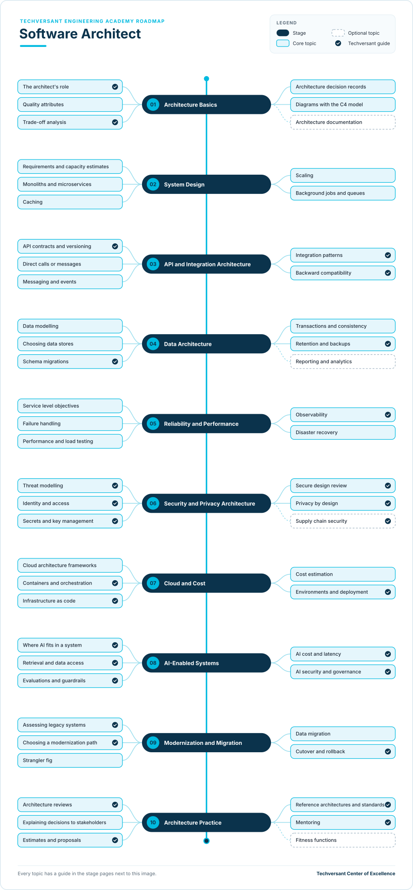

# Software Architect Roadmap

**Status:** Draft · **Owner:** CoE Team · **Last updated:** 2026-11-06 · **Next review:** 2027-02-06

A software architect at Techversant shapes how a client's system is built, so that it meets the client's goals and
stays reliable, secure, affordable and easy to change. The architect makes the key technical decisions, records
why, guides the team through delivery and checks the design as the client's needs change.

- **Who it is for:** senior developers, lead developers, DevOps or cloud engineers and forward deployed engineers
  who want to move into a software architect role. It continues the
  [Lead to Architect](../career-progression/04-lead-to-architect.md) career page.
- **Before you start:** several years of delivery on client projects, including designing at least one feature or
  service that went to production. If you have not yet completed
  [Engineering Foundations](../00-engineering-foundations/README.md), do that first.
- **What you do:** ten stages, each with a short guide to every topic and one hands-on project.

## Why It Matters

### The Value You Create

- **Decisions that hold up.** You write down each important decision and its trade-offs, so the team and the client
  know why the system is built the way it is, and nobody has to argue it again a year later.
- **Change stays affordable.** Clear boundaries between parts of the system mean the team can add features without
  breaking others, so the client's next request costs less.
- **Fewer surprises after launch.** You design reliability, security, cost and operations in from the start, instead
  of finding the gaps in production.
- **Estimates clients can trust.** You size the work and its risks before the contract is signed, so proposals are
  realistic.
- **Projects start from a stronger base.** What works becomes a reference architecture or a CoE standard that other
  Techversant teams reuse.

### How You Grow

- **The next step after lead developer.** The [Lead to Architect](../career-progression/04-lead-to-architect.md)
  career page describes the move; this roadmap gives you the skills and the evidence for it.
- **A clear path, with evidence at each level.** You move from Practitioner to Advanced (Solution
  Architect) to Expert. Each level lists the evidence your lead looks for (see [Levels](#levels)).
- **Wider influence.** You work across teams and projects, and you are in the room for client decisions and
  proposals.
- **A say in how Techversant builds software.** At Expert level, you set standards and reference architectures that
  other teams follow, and you mentor other architects.

## What a Software Architect Does

On a Techversant project, the architect's work runs like this:

1. Understand the client's business goal and the quality attributes that matter most, such as availability, cost or
   time to market.
2. Shape the solution and estimate it while the proposal is being written.
3. Record the key decisions as architecture decision records, and draw the system so everyone shares one picture.
4. Guide the team through the build: answer design questions, run spikes and review risky changes.
5. Make sure reliability, security, cost and operations are designed in, not added at the end.
6. Review the architecture as the system grows and the client's needs change.
7. Turn what worked into reusable references and CoE standards.

## How the Role Differs

How a software architect differs from the roles you may hold at Techversant today:

| Your role today | How a software architect differs |
|-----------------|----------------------------------|
| Senior developer | Designs and builds features well within an existing design. An architect sets that design, and decides how the parts of the system fit together. |
| Lead developer | Leads one team's delivery: plans the work, reviews code and reports progress. An architect owns the technical decisions behind the delivery, often across several teams or projects, and writes less of the code. |
| DevOps or cloud engineer | Builds and runs the platform, pipelines and infrastructure. An architect decides what the whole system needs from that platform, alongside the application, data and security design. |
| Forward deployed engineer | Takes one client problem to production, building most of it personally. An architect designs systems that several engineers build and maintain, and plans for years of change rather than one engagement. |

## Levels

| Level | What the architect does | Evidence |
|-------|-------------------------|----------|
| Practitioner | Designs parts of a system, such as a service, an API or a data model, with an architect reviewing | Projects for stages 01–05 verified, plus a reviewed design used on a real project |
| Advanced (Solution Architect) | Owns the architecture of a project end to end: decisions, reviews, risks and handover to the team | All ten projects and the capstone, plus the architecture record of a real project |
| Expert | Sets standards across projects, runs architecture reviews and mentors other architects | Standards or reference architectures used by other teams, and people mentored |

The levels follow the academy's [learning levels](../learning-levels/README.md), where the Architecture path runs
from Practitioner to Expert. Solution Architect is the target of this roadmap. Each topic's level shows the depth
expected of a Solution Architect. At Expert level, you apply the same topics across many projects and teams.

## Where You Start

Everyone completes all ten stages. Your current role decides where you can move quickly and where to plan more time.

| Stage | Senior developer | Lead developer | DevOps or cloud engineer | Forward deployed engineer |
|-------|------------------|----------------|--------------------------|---------------------------|
| [01. Architecture Basics](./01-architecture-basics.md) | Partly | Partly | New | Partly |
| [02. System Design](./02-system-design.md) | Partly | Already do | Partly | Partly |
| [03. API and Integration Architecture](./03-api-and-integration-architecture.md) | Partly | Already do | New | Already do |
| [04. Data Architecture](./04-data-architecture.md) | Partly | Partly | New | Partly |
| [05. Reliability and Performance](./05-reliability-and-performance.md) | New | Partly | Already do | Partly |
| [06. Security and Privacy Architecture](./06-security-and-privacy-architecture.md) | Partly | Partly | Partly | Partly |
| [07. Cloud and Cost](./07-cloud-and-cost.md) | New | Partly | Already do | Partly |
| [08. AI-Enabled Systems](./08-ai-enabled-systems.md) | New | New | New | Already do |
| [09. Modernization and Migration](./09-modernization-and-migration.md) | New | Partly | Partly | Partly |
| [10. Architecture Practice](./10-architecture-practice.md) | New | Partly | New | Partly |

- **Already do:** you do this in your current role. Show your lead the evidence for the project, then move on.
- **Partly:** you know some of the topics. Read the stage page and learn the rest.
- **New:** start at the beginning of the stage and plan the most time here.

What each role brings:

- **Senior developer:** you know how good code and good features are built. The new parts are system-wide decisions,
  operations, cost and leading design conversations.
- **Lead developer:** you already plan delivery, make design calls for your team and talk to stakeholders. The new
  parts are decisions that span teams, reliability and cost design, and formal architecture reviews.
- **DevOps or cloud engineer:** you already know how systems run, scale and fail. The new parts are application,
  API and data design, and explaining decisions to clients.
- **Forward deployed engineer:** you already integrate systems, build AI features and work with clients. The new
  parts are designing for many engineers and many years, and setting standards rather than delivering one result.

## The Roadmap

- Work from top to bottom. Each stage page explains every topic and ends with a project.
- **Solid boxes** are core topics. **Dashed boxes** are optional and depend on the project.
- A **tick** marks a Techversant guide: a standard, checklist, deliverable or academy path that covers the topic. The
  other topics link to official documentation, or are learned on projects with an architect.

## Stages and Projects

Each project has a verification checklist. A reviewer, architect or lead checks every item before the project
counts.

| Stage | Project |
|-------|---------|
| [01. Architecture Basics](./01-architecture-basics.md) | [Document the practice system as it is](./01-architecture-basics.md#project-document-the-practice-system-as-it-is) |
| [02. System Design](./02-system-design.md) | [Design for ten times the users](./02-system-design.md#project-design-for-ten-times-the-users) |
| [03. API and Integration Architecture](./03-api-and-integration-architecture.md) | [Design the mobile and notifications APIs](./03-api-and-integration-architecture.md#project-design-the-mobile-and-notifications-apis) |
| [04. Data Architecture](./04-data-architecture.md) | [Plan the data for growth](./04-data-architecture.md#project-plan-the-data-for-growth) |
| [05. Reliability and Performance](./05-reliability-and-performance.md) | [Set service levels and prove recovery](./05-reliability-and-performance.md#project-set-service-levels-and-prove-recovery) |
| [06. Security and Privacy Architecture](./06-security-and-privacy-architecture.md) | [Threat-model the growth design](./06-security-and-privacy-architecture.md#project-threat-model-the-growth-design) |
| [07. Cloud and Cost](./07-cloud-and-cost.md) | [Design the deployment and price it](./07-cloud-and-cost.md#project-design-the-deployment-and-price-it) |
| [08. AI-Enabled Systems](./08-ai-enabled-systems.md) | [Design the article summary feature](./08-ai-enabled-systems.md#project-design-the-article-summary-feature) |
| [09. Modernization and Migration](./09-modernization-and-migration.md) | [Plan the legacy blog migration](./09-modernization-and-migration.md#project-plan-the-legacy-blog-migration) |
| [10. Architecture Practice](./10-architecture-practice.md) | [Review a peer's design and propose a reference](./10-architecture-practice.md#project-review-a-peers-design-and-propose-a-reference) |

The projects build on each other. They all use the same [practice system](./practice-system.md): the open-source
RealWorld blogging app, a written growth brief from a fictional client, and the BlogCFC5 legacy blog the client
must migrate. Each project designs one part of the client's next year, and several ask you to prove a design
decision on the running app.

## Capstone

The ten verified projects form your capstone: the architecture of the practice system's next year. Present it to
your lead and two peers as a one-hour architecture review:

1. Walk through the context and container diagrams, and the five decisions that shaped the design most.
2. Show one decision you proved on the running app, such as a load test, a migration or a recovery drill, with the
   numbers.
3. Explain how the design meets the brief's service levels, security needs and monthly running budget.
4. Present the migration plan for the legacy blog, including how you would roll back.

Your lead signs off the capstone when every verification item is checked and all four parts are covered. Together
with the architecture record of a real project, this is the evidence for the Solution Architect level.

## How to Use It

1. Find your column in [Where You Start](#where-you-start).
2. Rate yourself on each topic: 0 not started, 1 aware, 2 can do it with help, 3 can do it alone.
3. Agree two or three gaps with your lead, and close them on real projects where possible.
4. Complete the projects for the stages you are working on.
5. Review your ratings with your lead every quarter.

## Glossary

| Term | Meaning |
|------|---------|
| ADR | Architecture decision record: a short document that records one decision, its context and its consequences |
| C4 model | A way of drawing software architecture at four levels: system context, containers, components and code |
| Quality attribute | A property the system must have beyond its features, such as availability, performance or security |
| SLI and SLO | Service level indicator and objective: what you measure about a service, and the target for it |
| Error budget | How much unreliability an SLO allows over a period, for example 0.1% of requests, or about 43 minutes of downtime, in 30 days for 99.9% |
| RTO and RPO | Recovery time objective and recovery point objective: how long recovery may take, and how much data may be lost |
| Threat model | A structured list of what can go wrong with a system's security, and what you do about each item |
| Strangler fig | Replacing a system piece by piece while the old one keeps running |
| Reference architecture | A proven design for a common kind of system that teams reuse as a starting point |
| Red Zone | Work Techversant never delegates to AI. See [section 2.2 of the AI Era Coding Guidelines](../../standards/general/ai-era-coding-guidelines.md#22-red-zone-manual-only). |
