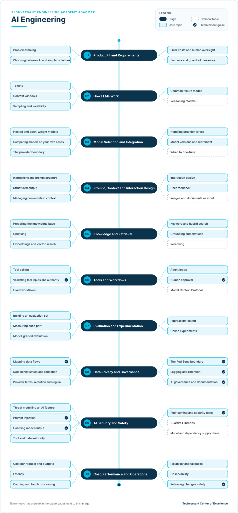

# AI Engineering Roadmap

**Status:** Draft · **Owner:** CoE Team · **Last updated:** 2026-11-09 · **Next review:** 2027-02-09

AI Engineering at Techversant means building and operating software features that use AI. This path covers product
fit, model integration, retrieval, tool workflows, evaluation, privacy, safety and production operations. It teaches
engineering judgment that transfers across model providers.

- **Who it is for:** software engineers building AI-backed product features, and engineers moving toward AI product
  engineering.
- **Before you start:** complete [Engineering Foundations](../00-engineering-foundations/README.md), or show
  equivalent evidence. You should be able to write and test a small API-backed Python application. TypeScript is also
  supported; see the [practice app](./practice-app.md).
- **What you do:** ten stages, each with a focused guide and project milestone. The milestones grow one synthetic
  support-case assistant into a tested, secure, production-ready service.

## How the Role Differs

| Techversant role | How AI Engineering differs |
|------------------|-----------------------------|
| Software engineer | Builds application features with predictable logic. An AI engineer decides where model behavior adds value, then measures and constrains its uncertainty. |
| Quality engineer | Validates product behavior and release risk. An AI engineer builds evaluation datasets and diagnostics into the feature lifecycle because outputs vary across runs and model changes. |
| Forward Deployed Engineer | Applies AI, integration and production skills inside a client engagement. This path develops deeper AI system design and evaluation skills that an FDE can apply on that engagement. |
| Software architect | Designs system-wide structure and trade-offs. This path focuses on the implementation, evaluation and operation of an AI-enabled feature within that architecture. |

## Levels

| Academy level | What the engineer demonstrates | Evidence |
|---------------|--------------------------------|----------|
| Foundation | Entry prerequisite, not an AI Engineering stage | Engineering Foundations or equivalent software, API, testing and security evidence |
| Practitioner | Builds a bounded AI feature with review, a fixed evaluation set and safe data handling | Stages 01–07 verified; can explain the model, retrieval and evaluation choices |
| Advanced | Owns an AI feature through security review, production readiness and measured improvement | All ten milestones and capstone verified, plus a production AI feature shipped or an equivalent supervised deployment |
| Expert | Improves AI engineering practice beyond one feature or team | Reusable evaluation, safety or operations patterns adopted by multiple teams; coaching evidence |

The path uses the academy-wide [learning levels](../learning-levels/README.md). Advanced is the target. Each stage
shows the depth expected at that level; Expert evidence comes from sustained work across engagements, not a course
certificate.

## Where You Start

Everyone completes the ten stages, but experience changes where to spend time.

| Stage | Software engineer | Quality engineer | FDE | Architect |
|-------|-------------------|-----------------|-----|-----------|
| [01. Product fit and requirements](./01-product-fit-and-requirements.md) | Partly | Partly | Already do | Already do |
| [02. How LLMs work](./02-how-llms-work.md) | New | New | Partly | Partly |
| [03. Model selection and integration](./03-model-selection-and-integration.md) | New | New | Partly | Partly |
| [04. Prompt, context and interaction design](./04-prompt-context-and-interaction-design.md) | Partly | Partly | Partly | Partly |
| [05. Knowledge and retrieval](./05-knowledge-and-retrieval.md) | New | New | Partly | Partly |
| [06. Tools and workflows](./06-tools-and-workflows.md) | New | New | Partly | Partly |
| [07. Evaluation and experimentation](./07-evaluation-and-experimentation.md) | New | Partly | Partly | Partly |
| [08. Data privacy and governance](./08-data-privacy-and-governance.md) | New | Partly | Partly | Partly |
| [09. AI security and safety](./09-ai-security-and-safety.md) | New | New | Partly | Partly |
| [10. Cost, performance and operations](./10-cost-performance-and-operations.md) | New | Partly | Partly | Partly |

- **Already do:** show evidence for the stage project to your reviewer and move on.
- **Partly:** review the stage, then complete the project items for the gaps you identify.
- **New:** learn the topics and complete the project milestone with a reviewer.

## The Roadmap

Each stage explains its topics, links to primary documentation and ends with a project milestone. Work on the
assistant in order; later stages extend the same service. The [practice app](./practice-app.md) defines the fixed
synthetic support cases, knowledge base and starter evaluation set used throughout.

## Stages and Projects

| Stage | Project milestone |
|-------|-------------------|
| [01. Product fit and requirements](./01-product-fit-and-requirements.md) | Define the support problem, non-AI baseline and success measure |
| [02. How LLMs work](./02-how-llms-work.md) | Measure tokens, context effects and output variation |
| [03. Model selection and integration](./03-model-selection-and-integration.md) | Compare a hosted model and an open-weight deployment option |
| [04. Prompt, context and interaction design](./04-prompt-context-and-interaction-design.md) | Build a streaming support conversation with clear uncertainty and feedback capture |
| [05. Knowledge and retrieval](./05-knowledge-and-retrieval.md) | Retrieve and cite the right support articles |
| [06. Tools and workflows](./06-tools-and-workflows.md) | Add a read-only case lookup with validated tool inputs |
| [07. Evaluation and experimentation](./07-evaluation-and-experimentation.md) | Run the shared evaluation set and diagnose component failures |
| [08. Data privacy and governance](./08-data-privacy-and-governance.md) | Map data flows and enforce the approved-data boundary |
| [09. AI security and safety](./09-ai-security-and-safety.md) | Test prompt injection and constrain model/tool authority |
| [10. Cost, performance and operations](./10-cost-performance-and-operations.md) | Deploy, observe, budget and roll back the feature |

## Capstone

Present the completed support-case assistant to a reviewer. Show the product requirement and baseline, the fixed
evaluation results, a retrieval failure and its diagnosis, a blocked injection attempt, the data-flow review, and a
production report covering latency, cost, errors and rollback. Use the same dataset and evaluation protocol for each
run. Compare scores only when model, version, prompt, settings and evaluator match; otherwise report the configuration
alongside the result.

## How This Fits Other Paths

- [FDE stage 04: Applied AI](../08-forward-deployed-engineering/04-applied-ai.md) teaches the working knowledge an
  FDE needs across an engagement. This path goes deeper on AI feature engineering and evaluation.
- [Architecture stage 08: AI-enabled systems](../04-architecture/08-ai-enabled-systems.md) covers system-level design choices. This
  path covers building, evaluating and operating the feature within those constraints.
- AI-assisted coding is in [Engineering Foundations stage 02](../00-engineering-foundations/README.md); AI-assisted
  test design is in [Quality Engineering](../02-quality-engineering/05-ai-assisted-testing.md). Follow the
  [AI Era Coding Guidelines](../../standards/general/ai-era-coding-guidelines.md) whenever AI tools help write code.

## References

Prefer primary technical documentation. Provider features and model availability change; check current docs and
record the model identifier and date for every evaluation run.

- [OpenAI Responses API](https://developers.openai.com/api/docs/guides/text) (hosted API worked example)
- [vLLM OpenAI-compatible server](https://docs.vllm.ai/en/stable/serving/online_serving/openai_compatible_server/) (optional open-weight deployment)
- [OWASP Top 10 for LLM Applications](https://genai.owasp.org/llm-top-10/)
- [NIST AI Risk Management Framework: Generative AI Profile](https://nvlpubs.nist.gov/nistpubs/ai/NIST.AI.600-1.pdf)
