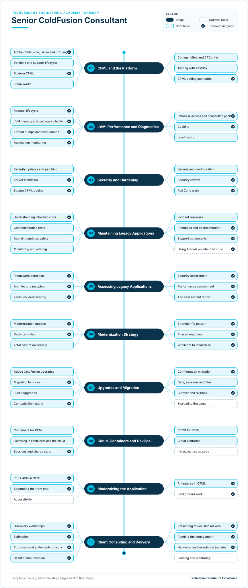

# Senior ColdFusion Consultant Roadmap

**Status:** Draft · **Owner:** CoE Team · **Last updated:** 2026-11-05 · **Next review:** 2027-02-05

A senior ColdFusion consultant looks after clients' CFML (ColdFusion Markup Language) applications and helps the
clients decide what to do with them. The consultant keeps the applications running and secure, assesses them,
recommends a modernization path, carries out upgrades and migrations, and manages the client relationship from first
meeting to handover.

- **Who it is for:** ColdFusion developers who want to lead client work, and senior developers or consultants who
  are taking over ColdFusion clients.
- **Before you start:** working CFML experience on at least one real application. If you are new to CFML, start with
  the [ColdFusion standards](../../../standards/coldfusion/) and a lead's guidance.
- **What you do:** ten stages, each with a short guide to every topic and one hands-on project.

## Why It Matters Now

- **Many clients are running unsupported versions.** Adobe ColdFusion 2018 lost all support in July 2024.
  ColdFusion 2021 has had no security updates since its core support ended on 10 November 2025; its extended
  support, which is best-effort migration help without security patches, ends on 10 November 2026
  ([Adobe support periods][adobe-eol], [Adobe ColdFusion blog][adobe-2021]).
- **Attackers target ColdFusion.** CVE-2026-48282, a path traversal flaw rated 10.0 by Adobe, is in the US
  government's catalog of known exploited vulnerabilities ([NVD][nvd]). Adobe fixed it in ColdFusion 2025 and 2023
  only ([Adobe security bulletins][adobe-sec]).
- **The cost model has changed.** ColdFusion 2025, released on 25 February 2025, is sold only as a subscription and
  runs only on Java 21 ([Charlie Arehart][carehart]). Clients upgrading from perpetual licenses need help comparing
  costs.
- **The open-source options have moved too.** Lucee 5.4 reached end of life on 31 December 2025 ([Lucee][lucee-eol]),
  and Ortus Solutions released BoxLang 1.0, a new JVM language that runs CFML, in May 2025 ([Ortus
  Solutions][boxlang]).

Each of these is a client conversation: a version to upgrade, a vulnerability to patch, a license to price or an
engine to evaluate.

## What a Senior ColdFusion Consultant Does

Most ColdFusion engagements are one of four types, and many clients move through them in order:

| Engagement | The client asks | Stages |
|------------|-----------------|--------|
| Support and maintenance | "Keep it running, patched and secure." | [02](./02-jvm-performance-and-diagnostics.md), [03](./03-security-and-hardening.md), [04](./04-maintaining-legacy-applications.md) |
| Assessment | "What state is it in, and what should we do?" | [05](./05-assessing-legacy-applications.md), [06](./06-modernization-strategy.md) |
| Upgrade or migration | "Move it to a supported version, or to Lucee, or to the cloud." | [07](./07-upgrades-and-migration.md), [08](./08-cloud-containers-and-devops.md) |
| Modernization | "Make it fit for the next five years." | [06](./06-modernization-strategy.md), [09](./09-modernizing-the-application.md) |

Stage [10](./10-client-consulting-and-delivery.md) covers the consulting work around all four: discovery, estimates,
proposals, communication and running the engagement.

## Levels

| Level | What the consultant does | Evidence |
|-------|--------------------------|----------|
| Contributor | Works on assessments, support and migrations, with a lead reviewing | Projects for stages 01–05 verified, plus work on a real engagement |
| Supported Lead | Leads discovery sessions, assessments or a migration, with peer review | Projects for stages 01–09 verified, plus a delivered assessment or migration |
| Lead Consultant | Owns client engagements end to end: scope, delivery, decisions and handover | All ten projects and the capstone, plus an engagement record with client feedback |
| Practice Lead | Shapes the practice: standards, reusable assets, estimates and mentoring | Assets used by other engagements, and consultants mentored to Lead |

The levels map to the academy's [learning levels](../../learning-levels/README.md): Contributor is Practitioner,
Supported Lead and Lead Consultant are Advanced, and Practice Lead is Expert. Lead Consultant is the target of this
roadmap. Each topic's level shows the depth expected of a Lead Consultant; topics at Expert level are for Practice
Leads.

Your level can differ by area. A performance specialist can lead technical work while still building client-facing
skills.

## From Your Role

| You are now | You probably have | Focus on |
|-------------|-------------------|----------|
| ColdFusion developer | Stage 01 and part of 04 | [02 JVM and performance](./02-jvm-performance-and-diagnostics.md), [03 Security](./03-security-and-hardening.md), [05 Assessing](./05-assessing-legacy-applications.md) |
| Senior ColdFusion developer or tech lead | Stages 01–04 | [05 Assessing](./05-assessing-legacy-applications.md), [06 Strategy](./06-modernization-strategy.md), [10 Client consulting](./10-client-consulting-and-delivery.md) |
| Consultant or senior developer new to ColdFusion | Stage 10 and parts of 06 and 08 | [01 CFML and the platform](./01-cfml-and-the-platform.md), [04 Maintaining](./04-maintaining-legacy-applications.md), [07 Migration](./07-upgrades-and-migration.md) |
| DevOps or cloud engineer | Stage 08 | [01 CFML and the platform](./01-cfml-and-the-platform.md), [02 JVM and performance](./02-jvm-performance-and-diagnostics.md), [07 Migration](./07-upgrades-and-migration.md) |

## The Roadmap

- Work from top to bottom. Each stage page explains every topic and ends with a project.
- **Solid boxes** are core topics. **Dashed boxes** are optional and depend on the client.
- A **tick** marks a Techversant guide: a standard, checklist, deliverable or academy path that covers the topic. The
  other topics link to official documentation, or are learned on engagements with a lead.

## Stages and Projects

Each project has a verification checklist. A reviewer, senior engineer or lead checks every item before the project
counts.

| Stage | Project |
|-------|---------|
| [01. CFML and the Platform](./01-cfml-and-the-platform.md) | [Run the practice app on two engines](./01-cfml-and-the-platform.md#project-run-the-practice-app-on-two-engines) |
| [02. JVM, Performance and Diagnostics](./02-jvm-performance-and-diagnostics.md) | [Find and fix a performance problem](./02-jvm-performance-and-diagnostics.md#project-find-and-fix-a-performance-problem) |
| [03. Security and Hardening](./03-security-and-hardening.md) | [Review and harden the practice app](./03-security-and-hardening.md#project-review-and-harden-the-practice-app) |
| [04. Maintaining Legacy Applications](./04-maintaining-legacy-applications.md) | [Take over the practice app for maintenance](./04-maintaining-legacy-applications.md#project-take-over-the-practice-app-for-maintenance) |
| [05. Assessing Legacy Applications](./05-assessing-legacy-applications.md) | [Assess the practice app](./05-assessing-legacy-applications.md#project-assess-the-practice-app) |
| [06. Modernization Strategy](./06-modernization-strategy.md) | [Recommend a modernization path](./06-modernization-strategy.md#project-recommend-a-modernization-path) |
| [07. Upgrades and Migration](./07-upgrades-and-migration.md) | [Migrate the practice app](./07-upgrades-and-migration.md#project-migrate-the-practice-app) |
| [08. Cloud, Containers and DevOps](./08-cloud-containers-and-devops.md) | [Containerize and ship the practice app](./08-cloud-containers-and-devops.md#project-containerize-and-ship-the-practice-app) |
| [09. Modernizing the Application](./09-modernizing-the-application.md) | [Add an API and an AI feature](./09-modernizing-the-application.md#project-add-an-api-and-an-ai-feature) |
| [10. Client Consulting and Delivery](./10-client-consulting-and-delivery.md) | [Run a mock engagement](./10-client-consulting-and-delivery.md#project-run-a-mock-engagement) |

The projects build on each other. Most use the same [practice app, BlogCFC5](./reference/practice-app-blogcfc5.md):
you run it, speed it up, harden it, take it over, assess it, migrate it, containerize it and extend it. Stage 06 uses
Scenario 0 of the [practice clients](./reference/practice-clients.md), which puts BlogCFC5 in a business setting;
stage 10 can use any practice client.

## Capstone

The ten verified projects form your capstone portfolio. Present it to your lead in one hour:

1. Show the practice app running in containers on its new engine, with the pipeline and a rollback.
2. Walk through your assessment report and the modernization recommendation that followed from it.
3. Explain one migration problem you found, how you fixed it and how your tests caught it.
4. Walk through the mock engagement: the estimate, the scope, one change request and the handover.

Your lead signs off the capstone when every verification item is checked and all four parts are covered. Together
with a real engagement record, this is the evidence for the Lead Consultant level.

## How to Use It

1. Find your row in [From Your Role](#from-your-role).
2. Rate yourself on each topic: 0 not started, 1 aware, 2 can do it with help, 3 can do it alone.
3. Agree two or three gaps with your lead, and close them on real work where possible.
4. Complete the projects for the stages you are working on.
5. Review your ratings with your lead every quarter.

## Supporting Material

| Folder | Contents |
|--------|----------|
| [deliverables/](./deliverables/README.md) | Templates, checklists and playbooks for client engagements |
| [reference/](./reference/coldfusion-deep-expertise-guide.md) | The deep expertise guide, the Lucee and Adobe comparison, the practice app and the practice clients |
| [ColdFusion standards](../../../standards/coldfusion/) | Techversant's ColdFusion best practices, style guide and code review checklist |

## Glossary

| Term | Meaning |
|------|---------|
| CI/CD | Continuous integration and continuous delivery: an automated pipeline that tests and deploys every change |
| CFML | ColdFusion Markup Language, the language that Adobe ColdFusion, Lucee and BoxLang run |
| Lucee | A free, open-source CFML engine |
| BoxLang | A JVM language from Ortus Solutions that can run CFML |
| CommandBox | A command-line tool that starts CFML servers and installs packages |
| CFConfig | A tool that exports and imports engine settings as a file |
| TestBox | A testing framework for CFML |
| Core support | The period when Adobe releases security updates and fixes for a version |
| Extended support | Adobe's best-effort help after core support ends; it does not include security patches |
| Characterization test | A test that records what the code does today, so you notice when a change alters it |
| Strangler fig | Replacing an application piece by piece while the old one keeps running |
| Cutover | The moment production traffic moves from the old system to the new one |
| SOW | Statement of work: the contract document that fixes scope, deliverables and terms |
| Red Zone | Work Techversant never delegates to AI. See [section 2.2 of the AI Era Coding Guidelines](../../../standards/general/ai-era-coding-guidelines.md#22-red-zone-manual-only). |

## Sources

- Adobe, [products and technical support periods][adobe-eol], for ColdFusion support dates
- Adobe ColdFusion blog, Kishore Balakrishnan, ["Planning ahead: ColdFusion 2021 support ending soon"][adobe-2021],
  March 2026
- NIST National Vulnerability Database, [CVE-2026-48282][nvd]
- Adobe, [ColdFusion security bulletins][adobe-sec], including APSB26-68
- Charlie Arehart, ["ColdFusion 2025 released"][carehart], 25 February 2025
- Lucee, ["Lucee roadmap 2025: 5.4 is EOL Dec 31st 2025"][lucee-eol]
- Ortus Solutions, [Into the Box 2025 keynote recap][boxlang], May 2025

[adobe-eol]: https://helpx.adobe.com/support/programs/eol-matrix.html
[adobe-2021]: https://coldfusion.adobe.com/2026/03/planning-ahead-coldfusion-2021-support-ending-soon/
[nvd]: https://nvd.nist.gov/vuln/detail/CVE-2026-48282
[adobe-sec]: https://helpx.adobe.com/security/products/coldfusion.html
[carehart]: https://www.carehart.org/blog/2025/2/25/coldfusion_2025_released
[lucee-eol]: https://dev.lucee.org/t/lucee-roadmap-2025-5-4-is-eol-dec-31st-2025/14760
[boxlang]: https://www.ortussolutions.com/blog/into-the-box-2025-keynote-day-1-recap
