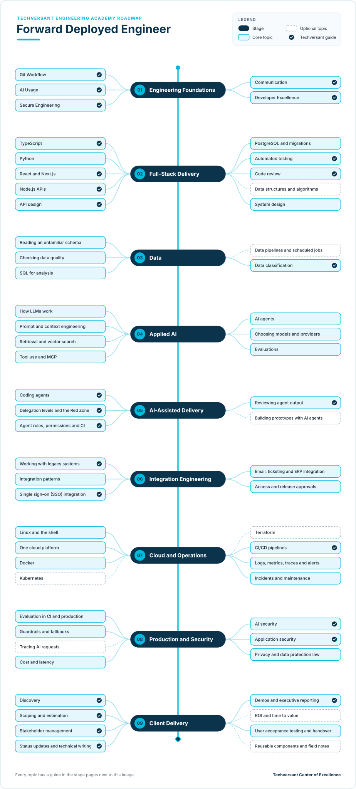

# Forward Deployed Engineer Roadmap

**Status:** Draft · **Owner:** CoE Team · **Last updated:** 2026-11-09 · **Next review:** 2027-02-09

A Forward Deployed Engineer (FDE) works with a client's team and takes a real problem all the way to working
software in production. FDEs write code, build AI features, connect systems they did not build, and work directly
with the client's people.

- **Who it is for:** senior developers, lead developers, software architects and AI engineers who want to work
  directly with clients.
- **Before you start:** working software engineering skills and some client project experience. Use the
  [entry diagnostic](#entry-diagnostic) to choose your starting point. Stage 01 is the
  [Engineering Foundations](../00-engineering-foundations/README.md) course; if you have completed it, show the
  evidence and move on.
- **What you do:** nine stages, each with a short guide to every topic and one hands-on project.

## Why It Matters

### The Value You Create

- **Clients get working software, not a report.** You take a problem from the first conversation to a solution
  running in production, and you measure the result against what the client agreed.
- **Clients see results sooner.** You test the riskiest idea first and work in short time boxes, so the client knows
  early whether the work is paying off.
- **The client's team can carry on without you.** You hand over a solution they can run, change and roll back.
- **The next engagement starts faster.** What you learn becomes reusable components and CoE standards that other
  Techversant teams use.

### How You Grow

- **A clear path, with evidence at each level.** You move from Practitioner to FDE Lead to Expert. Each level lists
  the evidence your lead looks for (see [FDE Levels](#fde-levels)).
- **Skills beyond your current role.** Senior developers add AI and client work. Lead developers add AI and direct
  ownership of the client result. Software architects add hands-on building and AI. AI engineers add integration,
  operations and client work.
- **Ownership of a whole engagement.** An FDE Lead owns the scope, the build, production and the handover. Explaining
  risk to non-specialists and tying technical work to business results are also part of the
  [Senior to Team Lead](../career-progression/03-senior-to-team-lead.md) and
  [Lead to Architect](../career-progression/04-lead-to-architect.md) paths.
- **A say in how Techversant works.** At Expert level, you turn field work into patterns and standards that other
  engineers follow, and you coach other FDEs.

## What an FDE Does

An FDE's work centres on three things: working directly with the client, building AI features, and connecting
them to the client's systems. At Techversant, an FDE engagement runs like this:

1. Find the real problem behind the client's request.
2. Agree a measurable result and a short time box.
3. Map the client's systems and data, and get access.
4. Build a prototype that tests the riskiest assumption first.
5. Build the production version and prove it works with evaluations.
6. Deploy it through the client's own change process, then run it.
7. Hand it over so the client's team can run it without you.
8. Feed what you learned back into reusable components and CoE standards.

## How the Role Differs

How an FDE differs from the roles you may hold at Techversant today:

| Your role today | How an FDE differs |
|-----------------|--------------------|
| Senior developer | Builds features from a backlog that someone else has agreed with the client. An FDE helps the client define that backlog, then builds it. |
| Lead developer | Leads a team through an agreed scope: plans the work, reviews code and reports progress. An FDE works inside the client's team, agrees the scope and the measure of success with the client, and builds much of the solution personally. |
| Software architect | Designs systems, sets technical direction and reviews other teams' work, often across several projects. An FDE also makes design decisions, but writes and ships the code on one client's systems and stays through production and handover. |
| AI engineer | Builds AI features within one product or project, with its own team and infrastructure. An FDE builds them inside the client's environment, under the client's rules. |

## FDE Levels

| FDE role label | Academy learning level | What the FDE does | Evidence |
|----------------|------------------------|-------------------|----------|
| FDE Practitioner | Practitioner | Delivers parts of an engagement, with a lead reviewing the key decisions | All stage projects verified, plus shipped work on a real engagement; can explain the domain and workflow learned |
| FDE Lead | Advanced | Leads an engagement end to end: scope, build, production, handover | An engagement record: scope, evaluation results including post-launch follow-up, handover, client feedback and domain-specific trade-offs |
| FDE Expert | Expert | Turns field work into reusable patterns and standards, and coaches other FDEs | Patterns used by other engagements; people coached; field evidence informs reusable practices and future delivery |

This is a specialist application of the academy-wide [learning levels](../learning-levels/README.md). Foundation is
the entry prerequisite: complete the entry diagnostic and show evidence of client delivery. FDE Practitioner, FDE
Lead and FDE Expert correspond to Practitioner, Advanced and Expert. FDE is not a first role.

Each topic's level is the depth expected of an FDE Lead. For Practitioner, the projects plus your real engagement
work should show working knowledge of every core topic.

Progression is based on demonstrated scope and independence, not time served. Practitioners deliver assigned parts
with review; FDE Leads make and explain end-to-end engagement decisions; Experts show that their learning improves
more than one engagement. Use the evidence in each stage project to support the level discussion with your lead.

## Entry Diagnostic

This roadmap is designed for engineers moving into customer-facing delivery, not as a first programming course.
Before starting, rate each capability from 0 to 3: 0 not started, 1 can follow a tutorial, 2 can build independently,
3 can debug and explain trade-offs. Link one piece of evidence for every score of 2 or 3.

| Capability | Ready-to-start evidence | If not ready |
|------------|-------------------------|--------------|
| Programming and debugging | Can make and explain a small change without following a walkthrough | Complete the relevant language path in [Engineering Foundations](../00-engineering-foundations/README.md) or the software engineering academy |
| Git, tests and code review | Can submit a tested change and respond to review | Complete the Git, testing and review foundations first |
| APIs and data | Can build or extend an API and query a relational database | Complete the relevant backend and data foundations first |
| Production delivery | Has contributed to a deployed service or can show equivalent cloud and operations work | Start with stages 07 and 08 alongside a lead before owning a client deployment |
| Client work | Has participated in a client project or can demonstrate stakeholder communication and delivery evidence | Pair with an experienced FDE on an engagement before taking independent client ownership |

You do not need to score 3 in every area. Agree gaps and a starting stage with your lead; use verified work evidence
to test out of topics you already know. A learner without software engineering foundations should complete those
first, then return to this roadmap.

## Where You Start

Everyone completes all nine stages. Your current role decides where you can move quickly and where to plan more
time.

| Stage | Senior developer | Lead developer | Software architect | AI engineer |
|-------|------------------|----------------|--------------------|-------------|
| [01. Engineering Foundations](./01-engineering-foundations.md) | Already do | Already do | Already do | Already do |
| [02. Full-Stack Delivery](./02-full-stack-delivery.md) | Already do | Already do | Partly | Partly |
| [03. Data](./03-data.md) | Partly | Partly | Partly | Already do |
| [04. Applied AI](./04-applied-ai.md) | New | New | New | Already do |
| [05. AI-Assisted Delivery](./05-ai-assisted-delivery.md) | Partly | Partly | Partly | Already do |
| [06. Integration Engineering](./06-integration-engineering.md) | Partly | Partly | Already do | New |
| [07. Cloud and Operations](./07-cloud-and-operations.md) | Partly | Partly | Partly | Partly |
| [08. Production and Security](./08-production-and-security.md) | Partly | Partly | Partly | Partly |
| [09. Client Delivery](./09-client-delivery.md) | New | Partly | Partly | New |

- **Already do:** you do this in your current role. Show your lead the evidence for the project, then move on.
- **Partly:** you know some of the topics. Read the stage page and learn the rest.
- **New:** start at the beginning of the stage and plan the most time here.

What each role brings:

- **Senior developer:** you already build and ship. The new parts are AI features and working directly with the
  client.
- **Lead developer:** you already plan delivery, review code, estimate and report to stakeholders. The new parts are
  AI features and owning the result directly with the client, with a smaller team and more of the building yourself.
- **Software architect:** you already design systems, choose integration patterns and weigh trade-offs with
  stakeholders. The FDE role is hands-on, so the new parts are building features yourself, including AI features,
  and staying with the work through production and handover.
- **AI engineer:** you already build AI features. The new parts are fitting them into a client's systems, cloud and
  release process, and working directly with the client.

## The Roadmap

- Work from top to bottom. Each stage page explains every topic and ends with a project.
- **Solid boxes** are core topics. **Dashed boxes** are optional and depend on the client.
- A **tick** marks a Techversant guide: a standard, checklist or academy path that covers the topic. The other
  topics link to official documentation, or are learned on engagements with a lead.

## Stages and Projects

Each project has a verification checklist. A reviewer, senior engineer or lead checks every item before the project
counts.

| Stage | Project |
|-------|---------|
| [01. Engineering Foundations](./01-engineering-foundations.md) | [Show your Foundations evidence](./01-engineering-foundations.md#project-show-your-foundations-evidence) |
| [02. Full-Stack Delivery](./02-full-stack-delivery.md) | [Build a service request tracker](./02-full-stack-delivery.md#project-build-a-service-request-tracker) |
| [03. Data](./03-data.md) | [Audit a real public dataset](./03-data.md#project-audit-a-real-public-dataset) |
| [04. Applied AI](./04-applied-ai.md) | [Build a standards assistant and prove it works](./04-applied-ai.md#project-build-a-standards-assistant-and-prove-it-works) |
| [05. AI-Assisted Delivery](./05-ai-assisted-delivery.md) | [Deliver a feature with a coding agent, safely](./05-ai-assisted-delivery.md#project-deliver-a-feature-with-a-coding-agent-safely) |
| [06. Integration Engineering](./06-integration-engineering.md) | [Connect the assistant to a ticketing workflow](./06-integration-engineering.md#project-connect-the-assistant-to-a-ticketing-workflow) |
| [07. Cloud and Operations](./07-cloud-and-operations.md) | [Deploy, break and recover](./07-cloud-and-operations.md#project-deploy-break-and-recover) |
| [08. Production and Security](./08-production-and-security.md) | [Harden the assistant for production](./08-production-and-security.md#project-harden-the-assistant-for-production) |
| [09. Client Delivery](./09-client-delivery.md) | [Run a mock engagement](./09-client-delivery.md#project-run-a-mock-engagement) |

The projects build on each other. The tracker from stage 02 is extended in stages 05 and 06 and deployed in stage 07. The
assistant from stage 04 is connected, deployed and hardened in stages 06–08. Both are used in the mock engagement.

## Capstone

The nine verified projects form your capstone portfolio. Present it to your lead in one hour:

1. Demo the deployed assistant working on a ticket, end to end.
2. Show the evaluation report and explain one failure and how you handled it.
3. Walk through the mock engagement: the scope, the result against the agreed measure and the handover.
4. Explain one thing you rejected from an AI tool and why.

Your lead signs off the capstone when every verification item is checked and all four parts are covered. Together
with shipped work on a real engagement, this is the evidence for the Practitioner level.

## How to Use It

1. Find your column in [Where You Start](#where-you-start).
2. Rate yourself on each topic: 0 not started, 1 aware, 2 can do it with help, 3 can do it alone.
3. Agree two or three gaps with your lead, and close them on real work where possible.
4. Complete the projects for the stages you are working on.
5. Review your ratings with your lead every quarter.
6. Revisit the entry diagnostic when your responsibilities change; ratings should reflect new evidence, not elapsed time.

## Glossary

| Term | Meaning |
|------|---------|
| Engagement | A time-boxed piece of client work with an agreed outcome |
| Discovery | Finding out what the client's problem really is, who has it and what it costs them |
| Time to value | How long until the client sees a measurable benefit |
| Evaluation set | Real examples with expected results, used to measure whether an AI feature works |
| Day 2 operations | Industry term for running a system after launch. See [Incidents and maintenance](./07-cloud-and-operations.md#incidents-and-maintenance). |
| UAT | User acceptance testing: the client's users confirm the solution does the job |
| Handover | Transferring ownership so the client's team can run, change and roll back the solution |
| Red Zone | Work Techversant never delegates to AI. See [section 2.2 of the AI Era Coding Guidelines](../../standards/general/ai-era-coding-guidelines.md#22-red-zone-manual-only). |
